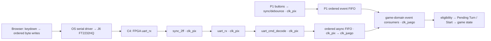

# CS-256 UART Input Path Research

Research checked **27 October 2026**. **Source fact** identifies published evidence; **Project application/proposal** identifies engineering interpretation. All new interfaces, encodings and implementation choices below are **proposals**, not team decisions or verified hardware. No HDL was implemented or simulated when this research note was written. The later [UART input experiment and findings](CS-256%20UART%20Input%20Prototype%20Findings.md) record portable tests and the separate status of Vivado/IP Catalog verification; they do not accept these proposals as team decisions.

## Summary and recommended block chain

**Proposal:** use a small SystemVerilog receiver on the existing Wizard-generated `clk_pix`, mid-bit counter sampling, a separate byte decoder, and an **ordered asynchronous FIFO with portable Gray-pointer RTL** into `clk_juego`. Apply game eligibility and the one-Pending-Turn rule **after** transport. This keeps the same logic testable in Icarus and Vivado. XPM FIFO remains the alternative if the team accepts a separate portable simulation model plus mandatory vendor-model tests.

**A FIFO alone cannot promise unconditional loss-free input.** At 115200 8N1 the wire can deliver `115200 / 10 = 11520` bytes/s; one command per 60 Hz edge consumes at most 60/s. Agree a bounded producer/service contract or add end-to-end credits/backpressure. Optional diagnostic echo is a separate extra.



The [contract §§1–4](../../proyecto_final/Contrato%20de%20interfaces%20game_top%20%28CS%20256%29.md) requires two RX synchronizer stages and lists a **proposed** `uart_rx` byte interface. Everything else in this table is illustrative; it does not revise the contract. `cmd`/`event` widths and values remain to be agreed.

| Block | Clock/domain | Illustrative ports or API | Responsibility |
|---|---|---|---|
| Browser controller | Laptop event loop | `keydown`, `port.writable` | Focused key presses → single bytes; serialize writes in arrival order. |
| `sync_2ff` | `clk_pix` | `input logic clk, rst, async_in; output logic sync_out` | Two adjacent synchronizer FFs, `ASYNC_REG`; initialize RX path high (idle). No edge detector before synchronization. |
| `uart_rx` | `clk_pix` | Contract proposal: `input logic clk, rst, rx; output logic [7:0] rx_byte; output logic rx_valid` | Confirm start low at half-bit; sample eight LSB-first bits and high stop bit; emit one-cycle valid only for good frames. Framing-error output/counter would be an extension. |
| `uart_cmd_decode` | `clk_pix` | `input logic clk, rst, rx_valid; input logic [7:0] rx_byte; output logic [2:0] cmd; output logic cmd_valid` | Normalize recognized bytes to four direction commands or Start; ignore others. No Heading/phase-dependent coalescing here. |
| Ordered CDC FIFO | Write `clk_pix`; read `clk_juego` | `input logic wr_clk, wr_rst, wr_en; input logic [2:0] wr_data; output logic full; input logic rd_clk, rd_rst, rd_en; output logic [2:0] rd_data; output logic empty` | Preserve accepted commands; independent pointers/flags; coordinated reset and overflow detection. Read timing/ready semantics require contract definition. |
| Game event consumers | `clk_juego` | Separate P1/P2 ports, e.g. `input logic event_valid_p1, event_valid_p2; input logic [2:0] event_p1, event_p2` | Consume transport events once, in each Player's order; check current Heading, phase and Pause; update Pending Turn or dispatch Start. |
| `btn_debounce` | Proposed `clk_pix` | Contract proposal: `input logic clk, rst; input logic [4:0] btn; output logic [4:0] btn_pulse` | Synchronize internally, debounce, produce press events; feed the same logical event format through a separate P1 queue. |

All internal resets remain synchronous active-high in their own domains; all proposed RTL follows `logic`, `snake_case`, one module/file and no array ports. The raw E3 board clock feeds only Wizards. Game state stays on the divided clock under [accepted ADR 0002](../adr/0002-follow-ta-divided-game-clock.md), consistent with the read-only [course handout, Drawing Logic Module steps 10–12](/home/alan/Documents/Maestría/CS-256/cs256-fall-2026/classproject/README.md).

## 1. Board bridge, pins and programming

**Source fact.** The FT2232HQ on **J6** provides UART with optional RTS/CTS. Its UART and JTAG functions are independent; one micro-USB cable carries both and can power the board. The manual names signals from the **PC/DTE perspective**. **JP3 selects power**; set USB for J6 power. **JP1 selects configuration mode**; JTAG programming works regardless of JP1, while its JTAG position prevents another boot source from configuring first. [Digilent manual §1.1 p.7, §2.1 pp.9–10, §6 p.14](https://digilent.com/reference/_media/reference/programmable-logic/nexys-a7/nexys-a7_rm.pdf).

| Package pin | Digilent XDC name | Direction at FPGA | Meaning |
|---|---|---|---|
| C4 | `UART_TXD_IN` | Input | PC TX → FPGA RX; contract `uart_rx`. |
| D4 | `UART_RXD_OUT` | Output | FPGA TX → PC RX; optional extra. |
| D3 | `UART_CTS` | Output | Drives bridge's active-low CTS input. |
| E5 | `UART_RTS` | Input | Receives bridge's active-low RTS output. |

**Source fact.** Pin assignments and LVCMOS33 are in [Digilent's master XDC, USB-RS232 Interface](https://raw.githubusercontent.com/Digilent/digilent-xdc/master/Nexys-A7-100T-Master.xdc), matching [the repository copy](../references/datasheets/Nexys-A7-100T-Master.xdc). CTS is an FTDI input; RTS is an FTDI output. [FT2232H datasheet §3 UART signal tables, pp.11/20](https://www.ftdichip.cn/Support/Documents/DataSheets/ICs/DS_FT2232H.pdf).

**Source fact.** The manual points to FTDI's free VCP drivers; FTDI supplies [OS-specific VCP packages](https://ftdichip.com/drivers/vcp-drivers/). Web Serial operates on OS-exposed serial ports. [Chrome: Web Serial](https://developer.chrome.com/docs/capabilities/serial).

**Project application/proposal.** Connect a data-capable cable to J6/PROG, select the UART serial interface, and verify OS enumeration; install a suitable driver if missing. Keep browser `flowControl: "none"` for the input-only baseline; D3/E5 are unused then. Never enable hardware flow control without implementing CTS. Programming replaces FPGA logic, so independent USB functions do not guarantee command delivery during reconfiguration. Do not confuse J6 with J5's USB HID host.

## 2. Official UART IP versus a small receiver

| IP | **Source fact** | **Project application/proposal** |
|---|---|---|
| AXI UART Lite, PG142 | AXI4-Lite slave, 16-character RX/TX FIFOs, configurable baud/data/parity, one stop bit. [PG142 pp.4–6, Overview](https://docs.amd.com/v/u/en-US/pg142-axi-uartlite). | Supports 115200 8N1, but retrieving bytes needs AXI register reads. Good for an existing processor/bus system. |
| AXI UART 16550, PG143 | AXI4-Lite register access, 16450/16550 compatibility, programmable framing, modem controls, interrupts, 16-character FIFOs. [PG143, Features](https://docs.amd.com/r/en-US/pg143-axi-uart16550/Features). | More functionality and configuration than this receive-only path needs. |

**Project inference.** Both need an **AXI master**, which could be a custom RTL bus controller; a CPU is not intrinsically required. Adding one merely to read UART registers complicates this processor-less course design. Neither internal FIFO resolves the subsequent fast-to-60-Hz crossing.

**Source fact / qualification.** “AMD has no non-AXI UART” is too broad. Xilinx's older **UART6** reference macros (`uart_rx6`, `uart_tx6`) have native FIFO signals, 8N1, a 16× baud enable, and can operate standalone. [Xilinx-authored UART6 User Guide, 30 September 2014, pp.2–4, university-hosted copy](https://viterbi-web.usc.edu/www-classes/engr/ee-s/201/ee201l_lab_manual/PicoBlaze/Picoblaze_KCPSM6_Release9_30Sept14/UART_and_PicoTerm/UART6_User_Guide_and_Reference_Designs_30Sept14.pdf). AMD still lists [PicoBlaze for Artix-7](https://www.amd.com/en/products/adaptive-socs-and-fpgas/intellectual-property/picoblaze.html). UART6 is legacy reference material, not a demonstrated current standalone Vivado catalog alternative here; its primitive dependencies and distribution terms require checking.

**Recommendation — proposal.** Write a small, documented RTL RX FSM. It matches the byte/pulse interface, avoids AXI and legacy primitive dependencies, exposes framing behavior to tests, and is easier to explain at the individual pre-demo. This is a project fit judgment, not an AMD requirement.

## 3. CDC comparison and loss-free scope

### Options

| Option | **Source fact** | **Project application/proposal** |
|---|---|---|
| `XPM_CDC_SINGLE` | Transfers one level; input must receive at least two destination samples. [UG953, Introduction](https://docs.amd.com/r/2024.2-English/ug953-vivado-7series-libraries/XPM_CDC_SINGLE). | Suitable for slow levels, not a one-fast-cycle valid pulse or independently synchronized command bits. |
| `XPM_CDC_PULSE` | Requires falling-to-next-rising gap ≥`2 × max(Tsrc,Tdst)`. [UG953, Introduction](https://docs.amd.com/r/en-US/ug953-vivado-7series-libraries/XPM_CDC_PULSE). | At 60 Hz, ≥33.33 ms; UART frames can arrive every 86.81 µs. No payload buffering; unsuitable by itself. |
| `XPM_CDC_HANDSHAKE` | Coherent bus transfer; complete acknowledge/rearm before another send; synchronizers configurable 2–10 stages, defaults four. [UG953, Introduction/ports](https://docs.amd.com/r/2024.2-English/ug953-vivado-7series-libraries/XPM_CDC_HANDSHAKE). | Safe mailbox with upstream queue/backpressure, but multiple slow edges per transaction. Four destination stages alone cost about 66.7 ms; measure the entire round trip. |
| `XPM_FIFO_ASYNC` | Independent write/read ports and full/empty protection. [UG953, Introduction](https://docs.amd.com/r/2024.2-English/ug953-vivado-7series-libraries/XPM_FIFO_ASYNC). | Vendor CDC implementation; preserves ordered buffered traffic, subject to capacity and reset readiness. |
| Portable Gray-pointer async FIFO | Binary local pointers, synchronized Gray pointers, local full/empty comparisons, power-of-two storage. [Cummings, SNUG 2002 rev.1.2, §§2–5, 7–8](https://www.researchgate.net/profile/Clifford-Cummings/publication/252160343_Simulation_and_Synthesis_Techniques_for_Asynchronous_FIFO_Design/links/54bfe9720cf28eae4a66418a/Simulation-and-Synthesis-Techniques-for-Asynchronous-FIFO-Design.pdf). | **Recommended proposal** for identical Icarus/Vivado RTL. More design/constraint/reset review than XPM; portability alone does not prove CDC safety. |
| Latest pending register + sticky Start, handshaken | Handshake coherency does not preserve overwritten information. | Reject as a substitute for the ordered stream; see counterexamples below. |

### XPM depth, reset, ratio and simulator caveats

**Source fact.** UG953 specifies power-of-two `FIFO_WRITE_DEPTH` **16–4194304**; effective depth differs by read mode. `CDC_SYNC_STAGES` is 2–8, but <5 at depth 16. Clocks must free-run; `rst` is synchronous to `wr_clk`, released with clocks stable. Inhibit accesses during reset/busy; await busy completion before another reset. [UG953, attributes/ports](https://docs.amd.com/r/2024.2-English/ug953-vivado-7series-libraries/XPM_FIFO_ASYNC).

**Source fact / limit of evidence.** The checked XPM section and reset diagram do **not specify a numeric minimum assertion width in slower-clock cycles**. Its figure shows a no-access interval extending past reset and involving read-clock synchronization. No maximum read/write clock ratio is stated there. Standard-mode empty deassertion is `1 wr_clk + (N+2) rd_clk`. [UG953 2024.2 pp.33–39, especially Fig.4 p.34](https://download.amd.com/docnav/documents/UG953_2024.2_English.pdf#page=34).

**Source fact — distinguish other FIFOs.** Native 7-series FIFO primitives require reset covering **five read and write clock cycles**. [UG473, FIFO Operations / Reset, p.53](https://docs.amd.com/api/khub/documents/9gZGbqBxtlKXxBfkBt~lAg/content). FIFO Generator recommends at least **max(3, C_SYNCHRONIZER_STAGE)** slower cycles for its asynchronous reset. [PG057 v13.2, Resets, p.127](https://docs.amd.com/api/khub/documents/Ds0JjAYlvIFpRMxJMOrbRw/content). Neither is automatically the external reset contract of XPM_FIFO_ASYNC.

**Project application/proposal.** Do not label “five slower cycles” an established XPM requirement. If choosing XPM, inspect the **installed Vivado version's** macro/testbench and establish reset assertion and busy-completion bounds. A conservative candidate assertion of five 60-Hz periods is **83.33 ms**, followed by busy completion; this is a proposal requiring verification. With `N=2`, the documented standard-mode empty visibility term alone is about **66.67 ms**. That latency matters for controls even though serial bits are decoded quickly. The ~1,391,000:1 clock ratio is not expressly prohibited by the cited XPM section, but is not validated by this research. Keep `clk_juego` running during Pause. Determine clock relationship from generated clocks/constraints before setting `RELATED_CLOCKS`; sharing E3 alone is insufficient timing evidence.

**Source fact.** AMD's supported simulator list includes Vivado Simulator and named commercial simulators, **not Icarus**. [UG900 2024.2, Supported Simulators](https://docs.amd.com/r/2024.2-English/ug900-vivado-logic-simulation/Supported-Simulators).

**Project application/proposal.** XPM is not an Icarus built-in. Some macro subsets may compile with supplied sources, but full library compatibility is **unverified**, not guaranteed or categorically impossible. Vendor primitives/assertions can require additional support. An Icarus behavioral replacement proves surrounding logic, not the actual XPM implementation. Prefer portable FIFO RTL here; if selecting XPM instead, use a wrapper and test it with actual XPM libraries in Vivado, including reset/busy and output latency.

### Recommended FIFO contract — proposal, not yet accepted

- Start sizing with **64 entries**, one recognized command per word, and one consumed per game edge using a defined read-valid convention. This is not a 64-entry gameplay Turn queue: consumed commands are judged immediately; only one valid Pending Turn survives.
- Establish `usable_capacity > burst + producer_rate × longest_no_service_time`, plus CDC/in-flight margins, with sustained producer rate below **measured** consumer rate. Example candidate: ≤20 commands/s, burst ≤8, no auto-repeat; include startup, serial-driver burst delivery and any game/service stalls. A 64-word queue fills in about **5.6 ms** under sustained recognized bytes at line rate despite a 60/s consumer.
- A page-side FIFO must retain/rate-limit input in order, with a visible full/disconnected state. Disabling `event.repeat` alone is no rate guarantee. `await writer.write()` is not an FPGA consumption acknowledgment. An unrestricted sender needs **credits/ACKs on D4** or a proven CTS hardware backpressure design on D3; leave capacity for bytes already in flight. Those extend the agreed input-only interface. No finite FIFO makes an unthrottled wire unconditionally loss-free.
- Use local binary pointers with an extra wrap bit and registered Gray pointers; synchronize only pointers through two FFs. Keep payload in stable dual-port storage. Prevent write-full/read-empty, and make overflow sticky/observable rather than silently claiming success. Internal memory arrays are compatible with the prohibition on **array ports**.
- Coordinate reset in both domains; clear pointers, partial UART frames and event eligibility together; keep traffic disabled until both sides are ready. Never reset just one FIFO pointer while the other continues. Do not copy the paper's asynchronous active-low resets unchanged into this project's synchronous active-high interface.
- Review pointer routing constraints, `ASYNC_REG`, inferred storage and clock definitions. AMD describes bounded datapath delay or bus-skew constraints for Gray CDC; blanket clock-group exceptions can override required max-delay constraints. [UG949, Constraints on Individual CDC Paths](https://docs.amd.com/r/en-US/ug949-vivado-design-methodology/Constraints-on-Individual-CDC-Paths), [UG903, About Bus Skew Constraints](https://docs.amd.com/r/en-US/ug903-vivado-using-constraints/About-Bus-Skew-Constraints). RTL simulation cannot establish metastability MTBF or routed skew safety.

### Why latest-turn plus sticky Start is insufficient

**Project authority.** The [agreed specification, Movement, Turns and Crashes](../decisions/CS-256%20Tron%20Agreed%20Specification%202026-10-20.md#movement-turns-and-crashes) preserves request order, judges validity against current Heading, and allows one Pending Turn, replaced only by a **valid** request. Same-Heading/reversal requests cannot cancel it. Steering outside Play, including Pause, is ignored.

**Project deduction.** Heading RIGHT, receive UP then LEFT before the next Step: UP is valid and LEFT is a reversal against RIGHT. A raw “latest direction” becomes LEFT and loses the valid UP. A fast validity-aware register would need a coherent, timely Heading/phase copy and an explicit boundary when game Heading changes. Start then UP and UP then Start also collapse to the same `(start=1, direction=UP)` snapshot despite different eligibility. A sticky Start can carry an ignored Crash-time press into Ready, violating the required **fresh Start**.

**Proposal.** Preserve transport order and judge commands in the game domain. A compressed per-tick batch might preserve gameplay outcomes if it carries sufficient ordering/eligibility information and is proved equivalent; a single direction plus Start bit is not that proof and does not literally deliver every event. Adopting semantic compression requires explicit team agreement about the transport requirement.

**Proposal / open boundary.** FIFO delay also creates stale-event risk. Specify whether eligibility uses arrival or dequeue time, and order each event against the Step edge. Prefer capture-time tick/phase-epoch metadata from a coherent boundary protocol, invalidating obsolete steering/Start across Pause, Crash, reset and Round transitions. Drain/discard ineligible traffic while paused; never freeze transport and replay paused steering on resume. A delayed phase bit sampled independently in the fast domain is insufficient. Metadata fields, boundary timing and handling of an existing Pending Turn on Pause remain contract work.

## 4. Receiver clock and baud arithmetic

**Source fact.** The handout requests 83.46 MHz but warns that Clocking Wizard achieves a nearby frequency. [Course handout, Creating the Clock steps 3–4](/home/alan/Documents/Maestría/CS-256/cs256-fall-2026/classproject/README.md). **Project proposal:** reuse `clk_pix`; another Wizard-generated 100 MHz output is an alternative, not permission to clock the RX directly from E3. Record the actual generated frequency and recalculate parameters.

**Project calculations**, nominal `B=115200`, `Tbit=1/B=8.680556 µs`, ten bits/frame. Mid-bit counter: `N=round(F/B)`, sample start near `N/2`, then every `N` clocks. Integer 16× enable: `D=round(F/(16B))`, effective bit period `16D` clocks. In both cases `baud_actual=F/cycles_per_bit`, `error=100×(baud_actual/B−1)`. Counters count `0…N−1` or `0…D−1`.

| Fast clock F | Method | Calculation of divisor | Clocks/bit | Effective baud | Error |
|---|---|---|---:|---:|---:|
| 83,460,000 Hz | Mid-bit | `F/B=724.479167 → N=724` | 724 | `83460000/724=115276.243` | +0.066183% |
| 83,460,000 Hz | Integer 16× | `F/(16B)=45.279948 → D=45` | 720 | `83460000/(16×45)=115916.667` | +0.622106% |
| 100,000,000 Hz, Wizard output | Mid-bit | `F/B=868.055556 → N=868` | 868 | `100000000/868=115207.373` | +0.006400% |
| 100,000,000 Hz, Wizard output | Integer 16× | `F/(16B)=54.253472 → D=54` | 864 | `100000000/(16×54)=115740.741` | +0.469393% |

**Project proposal.** Mid-bit timing gives ample resolution on either clock. A 16× design can majority-vote central samples for noise rejection; 16× sampling alone does not imply majority voting. A fractional accumulator avoids the integer 16× average-baud error but adds complexity. Check start low at half-bit to reject short false starts, check the stop bit, recover from break/low-held RX, and require idle high before rearming after a framing fault. A 2-FF synchronizer is not a noise filter.

**Source fact.** FTDI's AN_120 explicitly covers FT2232H; §3 describes a 3 MHz baud base and eighth-step divisors for rates up to 3 Mbaud, while §4.4 describes its 12 MHz option. AN232B-05 supplies the earlier divisor method. [AN_120 §§3, 4.4, pp.4/10](https://www.ftdichip.com/Documents/AppNotes/AN_120_Aliasing_VCP_Baud_Rates.pdf), [AN232B-05 §1.3, p.4](https://ftdichip.com/Support/Documents/AppNotes/AN232B-05_BaudRates.pdf).

**Project arithmetic/application.** `3000000/115200=26.041667`; nearest eighth divisor **26** gives **115384.615 baud, +0.160256%**. This is achievable with the documented low-rate method; it is not a measurement of the laptop driver. The 12 MHz method can arithmetically achieve `12000000/104.125=115246.098`, **+0.040016%**, but do not assume the OS selects it. Bridge/board oscillator tolerances must also enter the budget; USB packet latency affects arrival spacing, not UART bit baud.

**Project timing deduction.** Stop-bit center is 9.5 bit periods after the start edge. With ideal edge alignment, keeping that sample within its bit requires `9.5×|Trx/Ttx−1|<0.5`, about **5.26% period mismatch total**, before noise/setup margins. A start-phase uncertainty of one 16× sample reduces the simple bound to `(0.5−1/16)/9.5≈4.61%`. This is not a universal UART guarantee. FTDI gives a **±3% practical rate guideline**, not permission for both endpoints independently to err ±3%. [AN232B-05, Baud Rate Calculation](https://ftdichip.com/Support/Knowledgebase/an232b_05calc.htm). **Proposal:** target ≤2% total mismatch, verify ±2% and stress ±3% over start phases and back-to-back frames. Include receiver quantization, synchronization/detection delay and both clock accuracies.

## 5. Web Serial and command bytes

**Source fact.** `requestPort()` requires user activation; `getPorts()` returns previously authorized ports. An opened port exposes a writable byte stream. [Chrome, Open a serial port / Write to a serial port](https://developer.chrome.com/docs/capabilities/serial). `open()` takes baud, data bits, stop bits, parity and flow control. [MDN SerialPort.open, Parameters](https://developer.mozilla.org/en-US/docs/Web/API/SerialPort/open).

**Proposed API sequence**, documentation example only; the page is not implemented here:

```javascript
// Connect button's click handler, after feature/secure-context detection:
const port = await navigator.serial.requestPort();
await port.open({
  baudRate: 115200, dataBits: 8, stopBits: 1,
  parity: "none", flowControl: "none"
});
const writer = port.writable.getWriter();
// One ordered application send queue owns this writer:
await writer.write(Uint8Array.of(commandByte));
// On disconnect: finish/cancel stream operations, release locks, close port.
```

**Source fact.** Chrome desktop supports Web Serial from 89 on Windows/macOS/Linux/ChromeOS. Current MDN compatibility data lists Edge via Chromium, Safari unsupported, and **Firefox support starting at 151**; do not repeat the older blanket “Firefox never supports it” claim. [Chrome, Browser support](https://developer.chrome.com/docs/capabilities/serial#browser-support), [MDN publisher's Serial compatibility data](https://raw.githubusercontent.com/mdn/browser-compat-data/main/api/Serial.json). **Proposal:** use tested desktop Chrome/Edge for the course; feature-detect `"serial" in navigator` on the actual installed version. Firefox ≤150 lacks this support; a version entry is not board/driver validation.

**Source fact.** Secure contexts include HTTPS and localhost/loopback; MDN also classifies top-level `file://` URLs as trustworthy. [MDN Secure contexts, Top-level documents / Potentially trustworthy origins](https://developer.mozilla.org/en-US/docs/Web/Security/Defenses/Secure_Contexts). The current [WHATWG WebSerial standard](https://serial.spec.whatwg.org/) was readable; the [former WICG URL](https://wicg.github.io/serial/) returned no readable body in this research tool. **Proposal:** prefer localhost for reproducible local testing or HTTPS deployment; verify `window.isSecureContext`, API presence and permission behavior if distributing a standalone file. Ordinary HTTP on a LAN address is insufficient. No hosted backend is needed to send keyboard bytes locally.

**Source fact.** `keydown` targets the focused element and bubbles; `event.repeat` identifies auto-repeat. [MDN keydown](https://developer.mozilla.org/en-US/docs/Web/API/Element/keydown_event), [MDN repeat](https://developer.mozilla.org/en-US/docs/Web/API/KeyboardEvent/repeat). **Proposal:** enable controls only while connected and the control area is focused; ignore repeats, composing/editable targets and Ctrl/Alt/Meta shortcuts. Use `event.key.toLowerCase()` for typed WASD, map `event.key === "Enter"` explicitly, and prevent default only for captured controls (Space scrolling, Enter activation). On blur stop accepting keys and show focus status. No keyup/release byte is needed for discrete Turn requests.

### Proposed one-byte command encoding — team approval required

| Browser key | Browser byte | FPGA accepts | Decoded command |
|---|---|---|---|
| W / w | `0x77` (`w`) | `0x77`, `0x57` | P2 UP |
| A / a | `0x61` (`a`) | `0x61`, `0x41` | P2 LEFT |
| S / s | `0x73` (`s`) | `0x73`, `0x53` | P2 DOWN |
| D / d | `0x64` (`d`) | `0x64`, `0x44` | P2 RIGHT |
| Space | `0x20` | `0x20` | Start |
| Enter | **`0x0D` (CR), exactly one byte** | `0x0D` | Start |
| Anything else, including LF | No transmission | Ignore | None |

**Proposal.** Send no newline after WASD and no CRLF for Enter: accepting both CR and LF as Start could turn one terminal Enter into two events. Uppercase receive aliases support Caps Lock/terminal checks without changing the page's canonical lowercase encoding. The FPGA cannot distinguish a real press from an auto-repeated byte; page policy and transport capacity still matter.

**Optional TX extra — proposal.** D4 could echo accepted bytes or report framing/overflow counters for board bring-up. An echo at reception does not prove game consumption. A defined ACK/credit protocol can provide backpressure; it needs TX logic, response parsing, reset/session semantics and its own tests. If strict loss-free delivery under arbitrary offered load is required, a feedback mechanism becomes part of the required transport, not merely an optional debug echo.

## 6. P1 buttons and the common game interface

**Project authority.** P1 uses debounced board events in sampled arrival order; simultaneous valid directions use **UP > RIGHT > DOWN > LEFT**. BTNC supplies Start. [Contract §§3–4](../../proyecto_final/Contrato%20de%20interfaces%20game_top%20%28CS%20256%29.md).

**Proposal.** Synchronize/debounce in the fast domain, then queue press events in the same logical format as UART commands. Keep separate Player ports/queues so P2 bursts cannot starve P1; define simultaneous-event arbitration and Start merging without creating Player movement priority. Preserve enough information for Roman's game-domain validity check before applying the authorized direction tie-break. Choose/test the debounce duration. A fast `btn_pulse` wired directly to 60-Hz logic can disappear just like `rx_valid`.

## Verification plan — proposed, no results claimed

Track this work against [development-plan I1/I2/I3/X2](../plan/CS-256%20Tron%20Development%20Plan.md); Roman writes the independent official tests for Alan's input blocks.

| Testbench / check | Required observation |
|---|---|
| Single byte | `00`, `FF`, `55`, `AA`, every command/alias; LSB order, exact byte, exactly one valid pulse; unknown bytes produce no command. |
| Back-to-back frames | One stop bit, no extra gap; many recognized commands, randomized phase; no dropped/repeated bytes before FIFO full. |
| Framing/break | Low stop bit suppresses valid; sustained low produces no commands; idle-high recovery followed by a good frame works. |
| Baud tolerance | Independent transmitter timing, ±2% and ±3% total relative mismatch, both signs; sweep start phase and patterns at actual Wizard frequency. |
| Glitches | Short low pulse during idle does not become a command; inject data/stop glitches and document rejection limits. No unsupported noise-immunity claim. |
| Ordered CDC | Scoreboard compares accepted writes with reads across wrap/full/empty; randomized clocks/phases plus actual fast:60-Hz ratio; no duplication/reordering. Exercise FIFO full and the chosen backpressure/overflow policy. |
| Game semantics | RIGHT→UP→LEFT retains UP; RIGHT→UP→RIGHT retains UP; arrivals around a Step use the agreed Heading; Start-before-Turn differs from Turn-before-Start where eligibility requires it. |
| Reset during traffic | Reset every RX state and nonempty/full FIFO; repeated reset, skewed domain release, readiness interval; no ghost Start, stale byte or pointer disagreement. Actual XPM model/busy checks if selected. |
| Pause/Crash/Ready | Transport clocks continue; paused/Crash steering is discarded and never replayed; fresh-Start rule; old queued traffic across transitions cannot affect a new Round. Test the agreed paused-Start policy. |
| P1 | Realistic bounce/taps, held button, simultaneous directions, concurrent P2 traffic; common interface preserves each Player's defined ordering. |

**Proposed board checks:** J6/JP3/JP1, driver enumeration and permission grant on the actual Mac/Windows machines; terminal sends exact bytes without local newline conversion; browser captures only focused fresh presses. Observe C4 and RX/decode/FIFO counters with ILA or temporary LEDs; measure bit time and queue latency. Check optional D4 only if implemented. Program using the same cable, reconnect/reinitialize the controller, and perform repeated reset/Pause/Round transitions. Save achieved clock frequency, Vivado/IP versions, Icarus version, test logs, routed timing, `report_cdc` and pointer-skew evidence. Use accelerated clocks for broad logic tests **and** selected real-ratio tests; passing accelerated tests alone does not establish the latency/capacity budget.

## Open decisions for Roman and Alan

1. **Byte protocol:** approve CR-only Enter, uppercase aliases, LF-ignore and no auto-repeat policy.
2. **Clock/RX:** approve `clk_pix` reuse and mid-bit sampling; record achieved frequency, framing diagnostics and recovery policy.
3. **CDC:** approve portable FIFO versus XPM; settle payload/metadata, depth, read timing, reset/readiness and physical constraints. XPM's installed-version reset assertion/busy bounds and Icarus compatibility remain unverified.
4. **Loss-free operating contract:** specify burst/rate/service bounds and startup behavior. If unrestricted traffic is in scope, choose ACK/credits or CTS and amend the interface. Decide whether diagnostic TX alone is worth the extra work.
5. **Game boundaries:** define arrival versus consumption eligibility, event/Step ordering, Pause/Crash/Ready epochs, treatment of an existing Pending Turn on Pause, and **Start during Pause** (not settled by the locked specification). No stale Start may satisfy a later fresh-Start requirement.
6. **P1 integration:** debounce interval, tied-event representation/selection, per-Player queues and simultaneous Start merging.

These are proposals to reconcile in the interface contract before implementation. Any actual gameplay-rule change requires a later ADR; the locked decision files remain untouched.

## Source access and research limits

- Digilent's HTML manual returned **403**; its official PDF was reachable. FTDI `.com` full AN232B-05/AN_120/datasheet and VCP-page fetches returned **403/access errors**; indexed first-party excerpts supported baud/driver facts, and the FTDI-hosted `.cn` FT2232H PDF was reachable. Confirm actual driver-selected baud on the board.
- The unversioned AMD handshake URL returned **404**; the 2024.2 page worked. The generic simulator page timed out; its versioned page worked. Sources pinned to 2024.2 are research references, not a claim that this is the workstation's installed release.
- Sunburst's original Cummings URL redirected to an inaccessible library page; the author's ResearchGate PDF was reachable. UART6's Xilinx-authored guide was available through indexed text on a university mirror, but direct fetching returned **502**. Current official UART6 package availability/licensing was not established.
- The WICG URL returned no readable body; the current WHATWG standard was reachable.
- Local MinerU 4.0.8 could not access its read-only cache lock. Web-extracted source text was used; the downloaded official UG953 reset figure was also rendered and visually checked. No numeric XPM slower-cycle reset minimum or direct Icarus/XPM compile result was established; neither is invented here.
