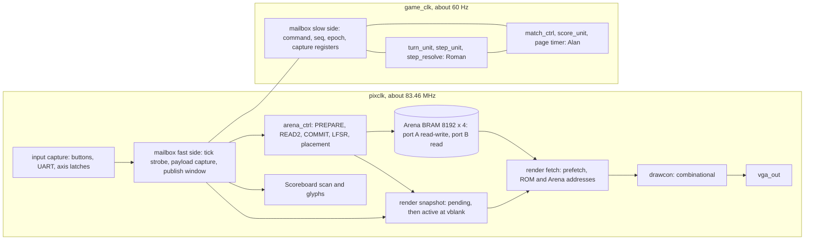

# CS-256 Tron Opus 5.5 Architecture and Integration Review

This is an independent architecture and integration review of the locked [[CS-256 Tron Agreed Specification 2026-10-20]], written for the Roman–Alan settlement meeting. It checks whether the specification faithfully records Q1–Q40, what must change in the team repository [romanmg00/FPGA](https://github.com/romanmg00/FPGA), and how the agreed slow game-state clock can be built. It does **not** change or reopen any agreed rule. Recommendations become decisions only after the team records them in the specification or the reconciled contract; see [[CS-256 Tron Architecture and Documentation Map#Authority and status]].

> [!warning] Parent review: architecture proposals remain unvalidated
> Read [[#Parent review and adoption limits]] before adopting §5 or executing the merge plan. The parent agrees with the main integration findings but has not accepted the custom CDC circuit, mid-frame rendering policy, or repository-conversion procedure.

> [!info] Labels used below
> **Verified** means read directly in the cited source. **Inference** means reasoning or arithmetic from verified facts; nothing in this category was executed in a simulator or on hardware. **Recommendation** is a proposed engineering or team choice.

## Evidence base and limits

- **Team repository, pinned.** `main` at [`f5cb82c901e33a453fcaea2720a80702fda54718`](https://github.com/romanmg00/FPGA/tree/f5cb82c901e33a453fcaea2720a80702fda54718), commit time 2026-10-15T14:37:51Z. A live `gh api` check at **2026-10-20 14:28 (+03:00)** found `main` unchanged, no other branch and no pull requests. The cached snapshot `/tmp/cs256-fpga-review` is **blob-identical** to that tree: all 32 `git hash-object` values match the API tree. Every team-repo citation below links to this SHA. Spaces and parentheses in the contract's path are percent-encoded.
- **Course repository (reference only).** `CS-256/cs256-fall-2026` HEAD is `fe88e9b` (2026-10-14). The working-tree changes to the two class-project READMEs are line endings only (`git diff --ignore-cr-at-eol` is empty), so the content I read equals HEAD. Nothing in that repository was modified.
- **Local notes.** Read on 2026-10-20 between about 14:15 and 14:50. The Agreed Specification and Team Decisions were unchanged during the review (mtime 14:21:34), so their line numbers are stable. A parallel documentation-control pass edited the README, Development Plan, VGA plan, Coding Practices and Glossary between 14:34 and 14:48, and created [[CS-256 Tron Documentation Control Review 2026-10-20]]. For those notes I cite headings, plus line numbers as of 14:50. I re-checked every drift item before listing it.
- **Not executed.** This machine has no `iverilog`, `xsim` or `vivado` on PATH, so there was no HDL simulation, synthesis, timing or CDC report. I did not rerun the Python suites; the earlier 17/35 passes cover the legacy rules, not the agreed ones. Timing figures are idealized arithmetic from `/tmp/opus-review-scripts/arith.py`.

## 1. Verdict

1. **The specification is faithful.** It consolidates Q1–Q40 without any unapproved gameplay rule (§3). Two carried-over baselines are not explicit Q items: the output-aligned, early-read pixel pipeline and the Sunday–Thursday planning week. The first is grounded in the handout and the TAs' strictness instruction, but it reverses Roman's contract and current `vga_out`, so the reconciled contract should record that he acknowledges it. A few edge behaviors are unspecified (Start while paused, the idle screen after power-up or reset, winner display before the HUD). Each can be answered in minutes.
2. **The project is not ready to integrate, and this blocks HDL work.** The designated implementation authority (the remote contract) still describes a different game and a single-clock architecture. Neither repository has an executable model of the agreed rules. The only HDL on `main` is a VGA counter skeleton. **X1 is missing**: the contract for how slow-clock Step logic and the fast Arena controller exchange commands, results, inputs and render state. Without it, Roman's G1/G2 and Alan's G3–G5/A2 cannot be written independently.
3. **The slow-clock architecture is feasible, given one discipline.** Every fast service the game needs is small next to a game tick. Step reads and writes, two worst-case Reward searches and a full 8,192-word Round preparation take at most about 0.5 ms (idealized), roughly 3% of one 16.7 ms tick. Design so that fast work finishes inside a bounded window after each tick and **never changes which tick an outcome lands on**. The shared model then needs only tick-level semantics. §5 gives a concrete design: a tick-aligned mailbox, a two-phase READ2/COMMIT Step with Reward replacement inside the commit, per-tick axis-latch input batches, and a render snapshot committed at vertical blanking.
4. **The largest non-technical risk is workload.** Alan's share concentrates the riskiest items (model migration, the CDC controller, inputs and UART, Scoreboard, top-level build). At 6–8 h per person per week there are about 22–30 h each before the tentative 15 November target.

**Do these before writing G-blocks:**
1. Commit the decision-time snapshot, which today exists only in `/tmp` ([[CS-256 Tron Repository Merge Plan#A. Preserve the decision-time evidence]]).
2. Merge Game_research into Roman's repository with its history (§8).
3. Reconcile the contract (F1, §4.3).
4. Settle D1–D4 (§6).
5. Deliver model v1 (§7, step S1).

## 2. Prioritized findings

Severity reflects the effect on integration. Pinned team-repo links use `C` for the contract `proyecto_final/Contrato de interfaces game_top (CS 256).md`.

### F1 — Critical: the designated implementation authority still specifies the superseded game and architecture

- **Verified.** The remote contract specifies:
  - **One pixel clock** with a `tick_60hz` frame enable, and engine updates timed to blanking ([C L26–L28](https://github.com/romanmg00/FPGA/blob/f5cb82c901e33a453fcaea2720a80702fda54718/proyecto_final/Contrato%20de%20interfaces%20game_top%20%28CS%20256%29.md#L26-L28), [L64](https://github.com/romanmg00/FPGA/blob/f5cb82c901e33a453fcaea2720a80702fda54718/proyecto_final/Contrato%20de%20interfaces%20game_top%20%28CS%20256%29.md#L64), [L168](https://github.com/romanmg00/FPGA/blob/f5cb82c901e33a453fcaea2720a80702fda54718/proyecto_final/Contrato%20de%20interfaces%20game_top%20%28CS%20256%29.md#L168), [L502–L508](https://github.com/romanmg00/FPGA/blob/f5cb82c901e33a453fcaea2720a80702fda54718/proyecto_final/Contrato%20de%20interfaces%20game_top%20%28CS%20256%29.md#L502-L508)).
  - **A shared PS/2 keyboard**, with buttons reserved for menus and `sw[5:0]` changing speed, colours and background at any time ([C L44–L46](https://github.com/romanmg00/FPGA/blob/f5cb82c901e33a453fcaea2720a80702fda54718/proyecto_final/Contrato%20de%20interfaces%20game_top%20%28CS%20256%29.md#L44-L46), [L321–L354](https://github.com/romanmg00/FPGA/blob/f5cb82c901e33a453fcaea2720a80702fda54718/proyecto_final/Contrato%20de%20interfaces%20game_top%20%28CS%20256%29.md#L321-L354)). The contract's `sw[0]` is a speed bit, but the agreement makes SW0 the Pause switch.
  - **One 2 × 2 *rayo*** with a configurable value and delay, menus, and a goal of 5–95 ([C L92–L101](https://github.com/romanmg00/FPGA/blob/f5cb82c901e33a453fcaea2720a80702fda54718/proyecto_final/Contrato%20de%20interfaces%20game_top%20%28CS%20256%29.md#L92-L101), [L317](https://github.com/romanmg00/FPGA/blob/f5cb82c901e33a453fcaea2720a80702fda54718/proyecto_final/Contrato%20de%20interfaces%20game_top%20%28CS%20256%29.md#L317), `CELL_RAYO = 7` at [L451](https://github.com/romanmg00/FPGA/blob/f5cb82c901e33a453fcaea2720a80702fda54718/proyecto_final/Contrato%20de%20interfaces%20game_top%20%28CS%20256%29.md#L451)).
  - **A 2-second countdown with pre-start steering**, an automatic next Round, and BTNC returning to the menu ([C L297–L303](https://github.com/romanmg00/FPGA/blob/f5cb82c901e33a453fcaea2720a80702fda54718/proyecto_final/Contrato%20de%20interfaces%20game_top%20%28CS%20256%29.md#L297-L303)).
  - **Points saturating at 99** ([L117](https://github.com/romanmg00/FPGA/blob/f5cb82c901e33a453fcaea2720a80702fda54718/proyecto_final/Contrato%20de%20interfaces%20game_top%20%28CS%20256%29.md#L117), [L468](https://github.com/romanmg00/FPGA/blob/f5cb82c901e33a453fcaea2720a80702fda54718/proyecto_final/Contrato%20de%20interfaces%20game_top%20%28CS%20256%29.md#L468)).
  - **A Scoreboard with P1 on the left** and a blank digit ([L418](https://github.com/romanmg00/FPGA/blob/f5cb82c901e33a453fcaea2720a80702fda54718/proyecto_final/Contrato%20de%20interfaces%20game_top%20%28CS%20256%29.md#L418)).
  - **Two HUD rows** and starts at (12,26)/(67,26) ([L440](https://github.com/romanmg00/FPGA/blob/f5cb82c901e33a453fcaea2720a80702fda54718/proyecto_final/Contrato%20de%20interfaces%20game_top%20%28CS%20256%29.md#L440), [L475–L477](https://github.com/romanmg00/FPGA/blob/f5cb82c901e33a453fcaea2720a80702fda54718/proyecto_final/Contrato%20de%20interfaces%20game_top%20%28CS%20256%29.md#L475-L477)).
  - **A three-person A/B/C split**, with `juego.py` as the HDL reference ([L514–L538](https://github.com/romanmg00/FPGA/blob/f5cb82c901e33a453fcaea2720a80702fda54718/proyecto_final/Contrato%20de%20interfaces%20game_top%20%28CS%20256%29.md#L514-L538)).

  The [root README](https://github.com/romanmg00/FPGA/blob/f5cb82c901e33a453fcaea2720a80702fda54718/README.md#L8-L32) repeats these rules. The specification acknowledges that none of this has been changed yet ([[CS-256 Tron Agreed Specification 2026-10-20#Authority, repository and team]], L33).
- **Consequence.** Both members currently lack a written interface consistent with the agreement. Work started from the contract would implement superseded rules.
- **Recommendation.** Make contract reconciliation the first integration step (S0 in §7), using the section-by-section checklist in §4.3. Derive `game_pkg.sv` constants from the specification.

### F2 — Critical: the slow-game/fast-service contract (X1) is undefined, and the obvious implementations break the agreed cadence or semantics

- **Verified.** The specification and ADR 0002 deliberately leave the transfer circuit, handshake and bounds open ([[CS-256 Tron Agreed Specification 2026-10-20#Clocks, Arena encoding and service boundary]], L123; [[0002-follow-ta-divided-game-clock#Consequences]]). The contract assumes the engine owns BRAM port A in the same clock domain with a one-cycle read ([C L74–L75](https://github.com/romanmg00/FPGA/blob/f5cb82c901e33a453fcaea2720a80702fda54718/proyecto_final/Contrato%20de%20interfaces%20game_top%20%28CS%20256%29.md#L74-L75), [L498](https://github.com/romanmg00/FPGA/blob/f5cb82c901e33a453fcaea2720a80702fda54718/proyecto_final/Contrato%20de%20interfaces%20game_top%20%28CS%20256%29.md#L498)) and assumes updates aligned to blanking ([L168](https://github.com/romanmg00/FPGA/blob/f5cb82c901e33a453fcaea2720a80702fda54718/proyecto_final/Contrato%20de%20interfaces%20game_top%20%28CS%20256%29.md#L168)).
- **Inference** (arithmetic using the UG953 semantics summarized in [[CS-256 Official FPGA Coding Practices#Transfer complete state and account for throughput]]):
  - (a) **A four-phase `XPM_CDC_HANDSHAKE` with a 60 Hz source** needs about 4–8 slow ticks per transfer (2–4 source synchronizer stages for both assert and release). A Step needs at least two transfers, so it exceeds the agreed six-tick Step.
  - (b) **Conventional 2-FF request/acknowledge with acknowledge-wait in the 60 Hz domain** spends 3 ticks per round trip. A READ followed by a COMMIT takes **exactly 6 ticks**: zero slack, and no tuning faster than 10 Cells/s.
  - (c) **A divided game clock is not aligned with vertical blanking**, so "update during blanking" cannot be guaranteed.
  - (d) **A placement race.** If a Reward is placed between a Step's read and its commit, the head write can overwrite a Reward whose slot still records it as present.
- **Consequence.** G1–G5, A2 and G4 cannot be designed independently, which risks a late redesign.
- **Recommendation.** Adopt the mailbox, the READ2/COMMIT Step and in-transaction Reward placement from §5.4–§5.6. Decide D2 and D3 now.

### F3 — High: Turn ordering across slow ticks has a latency hazard that can apply a 180° reversal

- **Verified.** The rules require one overwrite Pending Turn judged against the current Heading, ordered UART/keyboard events, sampled board order and a tie fallback (spec L55–L58). The Development Plan requires ordered transfer into the divided domain ([[CS-256 Tron Development Plan#W1 Tasks (18–22 Oct)]], L107 as of 14:50).
- **Inference.** Suppose validity is judged in the fast domain against a Heading register that changes only at Step commit, or at a slow edge the fast side has not yet observed. A request arriving inside that window is then judged against the old Heading. Example: heading RIGHT, pending UP launched at tick k; DOWN arrives before the fast side sees Heading = UP, so DOWN is accepted as valid. The next Step then turns the Bike from UP to DOWN, a 180° reversal into its own Trail. The alternative, an ordered event FIFO into a 60 Hz domain, has to process several events per tick and needs an asynchronous FIFO whose reset runs at 60 Hz.
- **Recommendation.** Use the per-tick axis-latch batch in §5.5. Update the Heading at Step **launch**, and keep the validity judgment in the slow domain (Roman's G1).

### F4 — High: the team's VGA skeleton and the contract's pipeline contradict the handout baseline in the specification

- **Verified.**
  - [`vga_out.sv` L23–L28](https://github.com/romanmg00/FPGA/blob/f5cb82c901e33a453fcaea2720a80702fda54718/proyecto_final/vga_out.sv#L23-L28) ties `tick_60hz` to 0 and computes `curr_x`/`curr_y` combinationally from the counters.
  - [L30–L43](https://github.com/romanmg00/FPGA/blob/f5cb82c901e33a453fcaea2720a80702fda54718/proyecto_final/vga_out.sv#L30-L43) registers sync and RGB with no reset branch, so `curr_x` leads the output pins by one pixel clock.
  - The contract delays sync and blanking by `DRAW_LATENCY` ([C L66](https://github.com/romanmg00/FPGA/blob/f5cb82c901e33a453fcaea2720a80702fda54718/proyecto_final/Contrato%20de%20interfaces%20game_top%20%28CS%20256%29.md#L66), [L128](https://github.com/romanmg00/FPGA/blob/f5cb82c901e33a453fcaea2720a80702fda54718/proyecto_final/Contrato%20de%20interfaces%20game_top%20%28CS%20256%29.md#L128), [L509](https://github.com/romanmg00/FPGA/blob/f5cb82c901e33a453fcaea2720a80702fda54718/proyecto_final/Contrato%20de%20interfaces%20game_top%20%28CS%20256%29.md#L509)) and gives `drawcon` a clock, a reset and the Arena read port ([L172–L196](https://github.com/romanmg00/FPGA/blob/f5cb82c901e33a453fcaea2720a80702fda54718/proyecto_final/Contrato%20de%20interfaces%20game_top%20%28CS%20256%29.md#L172-L196)).
  - The handout requires `curr_x`/`curr_y` to correspond to the pixel being drawn (*Visible Pixel Counter* step 1) and all `drawcon` logic to be combinational (*Drawing Logic Module* step 8). See [[CS-256/cs256-fall-2026/classproject/README#Visible Pixel Counter]] and [[CS-256/cs256-fall-2026/classproject/README#Drawing Logic Module]]. The specification adopts that baseline (L105).
- **Inference.** [`vga_out_tb.sv` L91–L107](https://github.com/romanmg00/FPGA/blob/f5cb82c901e33a453fcaea2720a80702fda54718/proyecto_final/vga_out_tb.sv#L91-L107) compares the registered `pix_*` against the current coordinates. It should report mismatches at x = 0 and x = 1280 of every line, about 1,600 per frame. This prediction comes from the local cycle model `tools/vga_out_tb_cycle_model.py`; neither I nor that tool ran a simulator.
- **Consequence.** An early-read lead computed against an output-aligned `curr_x` would be off by one pixel. Output alignment was not an explicit Q item and reverses Roman's design.
- **Recommendation.**
  - Roman revises `vga_out` and the tb, and the reconciled contract records his explicit acknowledgement of output alignment.
  - Either keep the handout's `assign` outputs, or register sync and RGB together and derive `curr_x`/`curr_y` from the registered stage (engineering task E4).
  - Remove `tick_60hz`.
  - Split rendering into a sequential `render_fetch` (prefetch addresses, memories) and a purely combinational `drawcon`.
  - Fix the tb: compare at the output-aligned coordinate, add `` `timescale ``, check the 1,391,040-cycle frame, and stop with `$fatal` on error.

### F5 — High: no shared executable model exists; both candidates implement superseded rules with incompatible encodings and PRNGs

- **Verified, local model.**
  - It has no Points Goal, and a Points comparison picks the winner ([`model/game.py` L126–L130](../../prototipos/tron_fpga/model/game.py)).
  - It applies a 99 cap (L107, L123; [`params.py` L123](../../prototipos/tron_fpga/model/params.py)) with values (3, 3, 5) and a +5 bonus (L122–L124).
  - It uses K = 4 frames per Step (L125), a default 8 px Cell (L38) and 3-bit codes without head codes ([`arena.py` L11–L16](../../prototipos/tron_fpga/model/arena.py)).
  - It places Rewards **before** Start ([`game.py` L56–L64](../../prototipos/tron_fpga/model/game.py)).
  - It uses a 32-bit Fibonacci LFSR advanced 32 shifts per draw ([`lfsr.py` L12–L13](../../prototipos/tron_fpga/model/lfsr.py)).
- **Verified, team model.**
  - It uses a 16-bit Galois `LFSR16` advanced every tick ([`juego.py` L28–L40](https://github.com/romanmg00/FPGA/blob/f5cb82c901e33a453fcaea2720a80702fda54718/prototipos/tron/juego.py#L28-L40), [L313](https://github.com/romanmg00/FPGA/blob/f5cb82c901e33a453fcaea2720a80702fda54718/prototipos/tron/juego.py#L313)).
  - It keeps the latest key and checks reversal only at the Step ([L104–L107](https://github.com/romanmg00/FPGA/blob/f5cb82c901e33a453fcaea2720a80702fda54718/prototipos/tron/juego.py#L104-L107), [L388–L391](https://github.com/romanmg00/FPGA/blob/f5cb82c901e33a453fcaea2720a80702fda54718/prototipos/tron/juego.py#L388-L391)). So RIGHT → UP → LEFT keeps going RIGHT, and a same-Heading press cancels a Pending Turn.
  - It has the *rayo*, the countdown and menus, and saturates Points ([L234–L235](https://github.com/romanmg00/FPGA/blob/f5cb82c901e33a453fcaea2720a80702fda54718/prototipos/tron/juego.py#L234-L235)).
- **Consequence.** There is no parity oracle, and existing test counts validate legacy behavior only.
- **Recommendation.** Settle D1 in §6.

### F6 — High: Arena initialization and encoding hazards at migration

- **Verified.**
  - Team `limpiar_arena` writes EMPTY to the HUD rows and to address padding ([`juego.py` L274–L279](https://github.com/romanmg00/FPGA/blob/f5cb82c901e33a453fcaea2720a80702fda54718/prototipos/tron/juego.py#L274-L279)).
  - The local clear writes WALL to every non-interior address (`arena.py` L49–L56). Local placement draws over the whole padded address space and rejects any non-EMPTY word (`rewards.py` L21–L41).
  - The specification forbids HUD overlap and defines code 1 as "Wall / inaccessible Cell" (L68, L116).
- **Inference.** Pairing the team's clear with a full-address random draw would put Rewards in the HUD band or in padding: invisible, unreachable, and breaking parity. Separately, a renderer that paints every code-1 Cell as Wall would draw Walls inside the HUD band.
- **Recommendation.** PREPARE writes code 1 to the HUD band (cy 0–3), the Wall ring and all padding. The Arena layer is drawn only for cy 4–49. Add a test that placement never selects a Cell outside cx 1–78 × cy 5–48.

### F7 — High: reset and Pause with in-flight transactions are unspecified, and a toggle protocol has a reset-order hazard

- **Verified.** The specification makes stale-transaction handling an obligation (L79–L80). The handout's first Clocking Wizard step unchecks reset and locked ([[CS-256/cs256-fall-2026/classproject/README#Creating the Clock]], step 3; [[CS-256 Official FPGA Coding Practices#RTL, inputs and startup]]).
- **Inference.**
  - A CPU_RESETN press shorter than about 2 slow ticks (33 ms) can reset the fast domain but be missed by a 2-FF synchronizer in the 60 Hz domain.
  - If the two domains leave reset in the wrong order, a toggle that drops from 1 to 0 creates a spurious "new command" edge, and a stale command executes after reset.
  - Aborting a Step at Pause can leave a half-written Arena.
- **Recommendation.** §5.9: stretch the reset to at least 4 ticks, derive the slow reset from the fast domain, tag commands with an epoch and sequence number, and let Pause gate Step launches only.

### F8 — Medium: Points/Lives widths still saturate

- **Verified.** The contract uses 7-bit Points saturating at 99 ([C L117](https://github.com/romanmg00/FPGA/blob/f5cb82c901e33a453fcaea2720a80702fda54718/proyecto_final/Contrato%20de%20interfaces%20game_top%20%28CS%20256%29.md#L117)) and 4-bit Lives (L116). Both models cap at 99. The specification removes the cap and requires widths that do not wrap (L50).
- **Inference.** The largest legal final total is 39 + 3 (Reward) + 3 (Survival Bonus) = **45** at goal 40. Six-bit Points and 2-bit Lives therefore suffice, and two decimal digits always fit.
- **Recommendation.** Remove saturation, assert Points ≤ 45 in tests and convert 0–45 to BCD.

### F9 — Medium: workload concentration and the schedule

- **Verified.** The ownership split is in the specification (L127–L133). The Development Plan assumes 6–8 h per person per week ([[CS-256 Tron Development Plan#Calendar and freezes]]).
- **Inference.** 20 October to 15 November is 3.7 weeks, about **22–30 h per person**. Alan's list holds the highest-risk items as well as G3/G5.
- **Recommendation.** Discuss D6, follow the sequence in §7, and build an early vertical slice.

### F10 — Medium: simulator choice and what the repository tracks

- **Verified.**
  - The team README targets Icarus on a Mac ([README L7](https://github.com/romanmg00/FPGA/blob/f5cb82c901e33a453fcaea2720a80702fda54718/README.md#L7)). The contract shapes ports for Icarus ([C L33](https://github.com/romanmg00/FPGA/blob/f5cb82c901e33a453fcaea2720a80702fda54718/proyecto_final/Contrato%20de%20interfaces%20game_top%20%28CS%20256%29.md#L33), [L489](https://github.com/romanmg00/FPGA/blob/f5cb82c901e33a453fcaea2720a80702fda54718/proyecto_final/Contrato%20de%20interfaces%20game_top%20%28CS%20256%29.md#L489)).
  - `.gitignore` excludes `prototipos/*/assets/*`, `hw/` and `*.bit` ([.gitignore L13–L20](https://github.com/romanmg00/FPGA/blob/f5cb82c901e33a453fcaea2720a80702fda54718/.gitignore#L13-L20)).
  - The vault README requires matching the workstation's Vivado version for IP ([README](../README.md#toolchain)).
- **Inference.** Icarus is not a dependable simulator for Vivado-generated Clocking Wizard, Block Memory Generator or XPM CDC models. Evidence must come from `xsim` at the pinned Vivado version. If COE or IP files land in an ignored path, builds are not reproducible.
- **Recommendation.** Make `xsim` the authoritative simulator and keep Icarus for pure-RTL smoke tests. Track `.xci`, `.coe`, PNG sources and Tcl build scripts; ignore generated outputs.

### F11 — Medium: details of building the two clocks

- **Verified.** The handout's step 10 instantiates a second clock divider and a counter ([[CS-256/cs256-fall-2026/classproject/README#Drawing Logic Module]]). The constraint guidance is in [[CS-256 Official FPGA Coding Practices#Path A — selected handout divided-clock implementation]], and its *Clock-domain transfers for Path A* section warns about unexpandable related clocks and that `set_clock_groups` overrides `set_max_delay`.
- **Inference.**
  - Two Clocking Wizard instances fed from the single E3 input will probably need the second wizard's input source set to *No buffer* or *Global buffer*, to avoid buffering one port twice. Verify this in the generated IP.
  - Treat the pixel-clock to game-clock relationship as asynchronous.
- **Recommendation.** See §5.2.

### F12 — Medium: Bike sprites cover the required white border at the playfield edges

- **Verified.** The specification requires a 10 px border, 32 px Bikes centred on 16 px head Cells, and playable pixels x 16–1263, y 80–783 (L99–L101). The handout's compositor gives the non-zero foreground priority (*Drawing Logic Module* step 7).
- **Inference.** A Bike at cx = 1 spans x 8–39, at cx = 78 spans x 1240–1271, and at cy = 48 spans y 760–791. Each overlaps the border by 2 px (x 0–9, x 1270–1279, y 790–799). Where the art is opaque, a literal foreground-wins compositor hides border pixels. The top edge is unaffected: at cy = 5 a Bike spans y 72–103.
- **Recommendation.** Draw the border above the sprites, or clip sprites to x 10–1269 × y 10–789. Include the edge cases in the frame-dump test (E6).

### F13 — Medium: some visible states are underspecified

- **Verified.** The specification does not say whether Start is honored while paused, what is shown after power-up or CPU_RESETN before the first Start, what the Scoreboard shows then, how the winner or a Draw is shown before the HUD exists, or how a crashed Bike looks once Match-over begins (L74–L80, L86–L95).
- **Recommendation.** D5 and D8, plus engineering defaults E6.

### F14 — Low: remaining documentation drift (re-checked at 14:50, after the documentation-control pass)

- The Development Plan's *Ownership* still says the module allocation is "included in the final meeting record **for review**" (L252). The specification records these as *Agreed responsibilities*, and the user locked the session. Remove the ambiguity.
- The vault README layout (L23–L28) and the VGA plan's file list (L256) still place `hdl/`, `sim/` and `evidence/` in the vault, while the implementation home is the team repository (README L34). The merge plan in §8 resolves this.
- The Glossary's *Wall* entry says the white frame "lies inside the Wall" (L85–L87). At the top the frame lies in the HUD band, which is inaccessible but is not the Wall row at cy = 4. This is a vocabulary nit.
- Both team READMEs are stale: [root](https://github.com/romanmg00/FPGA/blob/f5cb82c901e33a453fcaea2720a80702fda54718/README.md#L8-L32) and [`proyecto_final/README.md` L10–L22](https://github.com/romanmg00/FPGA/blob/f5cb82c901e33a453fcaea2720a80702fda54718/proyecto_final/README.md#L10-L22). The latter still describes a 640 × 480 counter as pending although `vga_out.sv` exists.
- The contract's open questions on the pixel clock and sync polarity ([C L634–L635](https://github.com/romanmg00/FPGA/blob/f5cb82c901e33a453fcaea2720a80702fda54718/proyecto_final/Contrato%20de%20interfaces%20game_top%20%28CS%20256%29.md#L634-L635)) are answered by the handout: 83.46 MHz, `hsync` low over 0–135, `vsync` high over 0–2 (*VGA Sync Signals* step 9, *Creating the Clock*).

## 3. Fidelity audit: the specification against Q1–Q40

**Result.** All 40 Q numbers are present in [[CS-256 Tron Team Decisions 2026-10-20#Live decision record]]; Q28/Q32 and Q31/Q34 are recorded jointly. Each maps to the specification without an unapproved change. This agrees with the independent check in [[CS-256 Tron Documentation Control Review 2026-10-20#No conflict found in the locked decision artifacts]].

| Q | Recorded decision | Specification location | Verdict |
|---|---|---|---|
| Q1, Q25 | Course and TAs first; team contract after reconciliation | *Authority…* L27–L33 | Faithful |
| Q2, Q7, Q11, Q13, Q39 | Goal win, Lives loss, `{SW15,SW14}` table, Step order, new-Match latch, no 99 cap | *Match, Points Goal and scoring* L37–L50 | Faithful. The width obligation in L50 is consistent (maximum 45) |
| Q3, Q9 | P1 board buttons, P2 browser WASD over UART; Start on BTNC or Space/Enter | *Start…* L82 | Faithful; Enter's encoding is open as engineering work |
| Q4, Q40 | Core scope; HUD after core; extras; tentative schedule | *Scope and tentative schedule* L137–L143 | Faithful |
| Q5, Q6, Q12, Q29, Q37 | Three slots +1/+1/+3; +3 bonus; temporary absence; PRNG policy; three initial Rewards before release | *Rewards and randomness* L66–L70 | Faithful; the generator and schedule are explicitly open |
| Q8, Q10 | Last valid Turn; event order; UP > RIGHT > DOWN > LEFT | *Movement, Turns and Crashes* L55–L58 | Faithful. The tie order was agent-selected under Q10's explicit authorization |
| Q15 | Six game-clock ticks per Cell | L54 | Faithful |
| Q14, Q17, Q23, Q35 | 16/32/16 px; 64 px HUD; 78 × 44 interior; starts; centred anchor; revisable | *Video, sprites and working layout* L100–L103 | Faithful; flexibility preserved |
| Q16, Q21, Q38 | 2-s blink; fresh Start; one press starts a new Match; final-Crash path | L74–L78 | Faithful |
| Q18–Q20 | Banks, labels, 3-s synchronized pages | *Physical Scoreboard* L86–L95 | Faithful |
| Q22 | SW0 Pause, CPU_RESETN, no clock gating | L79–L80 | Faithful; Start while paused is unspecified (D5) |
| Q24, Q36 | Native RGB444 COE, `000`/`0F0`, no `080`, cyan/orange | L104 | Faithful |
| Q26 | One shared model in the team repository | L31 | Faithful; base and layout open (D1) |
| Q27 | Four-bit codes | L111–L121 | Faithful |
| Q28/Q32 and the TA note | About 60 Hz game-state clock from the second Clocking Wizard plus divider; fast service | L109, L123 | Faithful. The "60 Hz only for display" ambiguity is resolved correctly |
| Q30, Q33 | Roman and Alan; HDL engine split | L31, L127–L133 | Faithful to the session lock; see F14 for the Development Plan's "for review" wording |
| Q31/Q34 | 15 and 23 November, tentative | L141–L143 | Faithful |

**Items that do not come from an explicit Q (carried-over baselines):**

| Item | Origin | Classification |
|---|---|---|
| Output-aligned `curr_x`/`curr_y`, early reads, combinational `drawcon` (L99, L105) | Handout text plus the TAs' strictness instruction plus local Decision B from 15 October | **Settled by course authority, not a preference to reopen.** It reverses Roman's `DRAW_LATENCY` design, so record his acknowledgement in the contract (F4) |
| Permanent Trails cleared between Rounds, a crashed Bike stays, no timeout (L59–L62) | Pre-meeting agreed mechanics | Settled |
| 115200 baud, 8N1 (L82) | 15 October UART agreement | Settled |
| Sunday–Thursday planning week (L143) | Local convention; the contract uses Monday–Sunday ([C L549](https://github.com/romanmg00/FPGA/blob/f5cb82c901e33a453fcaea2720a80702fda54718/proyecto_final/Contrato%20de%20interfaces%20game_top%20%28CS%20256%29.md#L549)) | Flexible process detail; align once |
| Fast controller as the only Arena writer (L123) | Q27 note and coding practices | Settled boundary; circuit open |

**Genuine holes, classified:**

| Gap | Kind | Where resolved below |
|---|---|---|
| X1 commands and results, CDC discipline, Step latency | Engineering, but both owners are affected | D2, D3, §5.4–§5.7 |
| Input batch semantics across ticks | Engineering at the boundary between the two owners | D4, §5.5 |
| Start while paused; idle screen and Scoreboard after power-up/reset | Small team rule (visible behavior) | D5 |
| Winner or Draw indication before the HUD | Optional team presentation choice | D8 |
| HUD and padding encoding; Arena layer extent | Engineering implied by L68 and L116 | F6, §5.8 |
| Sprite/border priority; crash-code location; blink; Bike state at Match-over | Engineering | E6 |
| PRNG, seed and placement schedule; fixed-seed selection | Engineering authorized by L70 | E1 |
| Enter wire encoding | Engineering authorized by L82 | E2 |

## 4. Integration matrix

Owners follow Q33. "Change" means the file has not been migrated yet; nothing below claims that any migration exists.

### 4.1 Team repository at `f5cb82c`

| Path | Current content (Verified) | Status against the agreement | Action | Owner |
|---|---|---|---|---|
| `README.md` | PS/2, *rayo*, menus, live switches, P1-left 7-segment | Superseded | Rewrite the game summary; link the reconciled contract | Alan (integration); Roman reviews |
| `.gitignore` | Ignores `prototipos/*/assets/*`, `hw/`, `*.bit` | Blocks tracked COE and IP | Track `assets/`, `ip/*.xci`, `.coe` and Tcl; keep `*.bit` ignored | Alan (build) |
| `nexys-a7-100t-master.xdc` | Vendor master file, all commented; the same pins as the course copy | Reference | Keep as the single vendor reference. Add `proyecto_final/constraints/game_top.xdc` and `cdc.xdc` | Alan; Roman supplies the clock constraints |
| `proyecto_final/Contrato de interfaces game_top (CS 256).md` | Superseded rules and single clock (F1) | Becomes the authority only after reconciliation | Reconcile using §4.3 | Both |
| `proyecto_final/counters.sv` | 0–1679 / 0–827 counters, synchronous reset | Compatible | Keep (one always block, as the handout's step 8 requires) | Roman |
| `proyecto_final/vga_out.sv` | `tick_60hz` tied to 0; registered outputs; `curr_x` leads | Does not meet L105 | Revise (F4, E4) | Roman |
| `proyecto_final/vga_out_tb.sv`, `counters_tb.sv` | Misaligned compare; print-only wrap check | Weak; predicted false failures | Rewrite as official, self-checking tbs | Alan (cross-test) |
| `proyecto_final/README.md` | Stale 640 × 480 steps | Stale | Update or fold into `docs/` | Roman |
| `prototipos/tron/config.py` | Legacy constants | Superseded | Replace with model parameters plus a checked `game_pkg.sv` | Alan (model); both review the package |
| `prototipos/tron/juego.py` | Legacy reference model: menus, PS/2, *rayo*, `LFSR16` | Superseded; the contract names it the reference at L536 | Retire as the authority. Salvage `arena_hex()` dumps and `BotTron` as a test driver | Alan |
| `prototipos/tron/main.py` | pygame viewer with PS/2 emulation; P1 on WASD, P2 on arrows | Viewer candidate | Turn into an adapter over the shared model, with player labels per the specification (P2 on WASD) | Alan today; see D6 |
| `prototipos/tron/fuente.py` | 8 × 8 font | HUD, after the core | Keep for H2 | Roman |
| `prototipos/tron/test_juego.py` | 35 tests of the legacy rules | Partly reusable | Port the head-on, order-independence, Arena-dump and rotation cases. Drop the menu, PS/2, finite-Trail, saturation and countdown cases | Alan; Roman reviews expected values |
| `prototipos/{lanzador.py, correr_pruebas.py, slither, mountain_crash, zombie_crossing}` | Launcher and earlier ideas | Not core | Freeze or archive | — |

### 4.2 Local components

| Path | Current content (Verified) | Action | Owner |
|---|---|---|---|
| `prototype/model/` | Headless and organized by hardware block. Already has the last-valid Pending Turn, read-before-write, three slots, a Start wait and Pause. Still has 3-bit codes, no goal, the cap, old values, K = 4, 8 px and 32-bit LFSR draws | **Recommended migration seed (D1).** Port it into the team repo and apply the change list in §4.4 | Alan |
| `prototype/tests/test_model.py` | 17 tests of the legacy rules | Port the structure; rewrite expectations to the specification | Alan; Roman reviews |
| `prototype/look/`, `tests/test_look_limits.py` | Viewer and effects, including the `080` glow and font-derived HUD height | Adapter over the shared model: fixed 64 px HUD, core art without `080` | Alan |
| `assets/candidates/*.png`, `tools/make_candidate_art.py` | Candidate art at 16/32/64 px and 4–32 px | Choose native 32 × 32 Bike and 16 × 16 Reward art; remove `080` | Roman (L3, P2, P3) |
| `tools/png2coe.py` | Planned, absent | Create in the team repo's `tools/` | Roman (L3) |
| `tools/vga_out_tb_cycle_model.py` | Prediction for the team tb | Keep as historical evidence | — |
| `docs/adr/0002-follow-ta-divided-game-clock.md` | Accepted ADR | Copy or link from the team repo's `docs/adr/` | Both |

### 4.3 Contract reconciliation checklist

1. **§0/§1:** replace the game summary with a link to the specification. Clocks become `pixclk` (first Clocking Wizard) plus `game_clk` (second Clocking Wizard, divider and BUFG) with the §5.4 mailbox. HUD = rows 0–3, Wall ring at cy 4/49 and cx 0/79, playable cx 1–78 × cy 5–48, code 1 for every non-playable address.
2. **§2 ports:** remove PS/2 and `sw[5:0]` aesthetics. Add `UART_TXD_IN` (C4), BTNU/BTNL/BTND/BTNR as P1 steering, BTNC for Start, CPU_RESETN (C12, active low), SW0 for Pause, SW15/SW14 for the goal, `seg`/`an` for the Scoreboard. Keep later extras off SW0, SW14 and SW15.
3. **§3 signals:** remove `tick_60hz`, menus, `desliz` and `cuenta`. Replace the *rayo* with three slot positions and presence flags. Points become 6-bit with no saturation; Lives 2-bit; the winner encoding includes Draw. Use the phase set in §5.3.
4. **Latency rule (§3):** replace `DRAW_LATENCY` sync delay with output-aligned coordinates plus early reads at the measured IP latency. `drawcon` becomes combinational.
5. **§4:** split `tron_engine` into Roman's `turn_unit` and `step_unit` (with a `step_resolve` function) and Alan's `match_ctrl`, `score_unit`, `arena_ctrl` and `cmd_mailbox`. Write the agreed rules in each. Specify the READ2/COMMIT/PREPARE transaction table (§5.6).
6. **`arena_map`:** port A belongs to `arena_ctrl` (read/write), port B to the renderer (read only), both on the same fast clock (recommendation E7). Use the read latency from the IP Summary and a defined write mode; PREPARE does the clearing.
7. **`lfsr`:** placeholder until E1 is recorded. It must not advance on `tick_60hz`.
8. **`seg7_driver`:** P2 on the left, P1 on the right; `P`/`L` glyphs; synchronized 3-s pages that reset to Points at a new Match.
9. **§5 `game_pkg`:** code 7 reserved and 8/9/10 for Reward slots. Remove `CELL_RAYO`, `SCORE_MAX`, `FRAMES_READY` and `MOVE_FRAMES[]`. Add `STEP_TICKS = 6`, `CRASH_TICKS ≈ 120`, `PAGE_TICKS = 180`, starts (20,27) RIGHT and (59,27) LEFT, the goal table {10,20,30,40}, Reward values {1,1,3}, bonus 3, and `STEP_LATENCY` from D3.
10. **§6 integration rules:** remove "update during blanking", "single clock" and the finite-tail rule. Keep "single writer" and "read before write". Add the mailbox, epoch, Pause and snapshot rules (§5.7).
11. **§7:** two-person ownership and the cross-test matrix (the specification's work division).
12. **§8:** tentative 15 and 23 November targets; fixed course dates.
13. **§9:** close the clock and polarity questions using the handout.

### 4.4 Proposed canonical repository structure and model governance

This is a proposal; none of these directories exist. The repository-wide layout, which keeps Roman's paths and imports Game_research with its history, is in [[CS-256 Tron Repository Merge Plan#Target structure]]. Hardware lives under Roman's existing `proyecto_final/` rather than a new top-level `hdl/`:

```text
proyecto_final/                         Roman's hardware root (contract and existing files stay)
  rtl/  pkg/game_pkg.sv
        video/ vga_out, counters, render_snapshot, render_fetch, drawcon       (Roman)
        game/  turn_unit, step_unit, step_resolve                              (Roman)
               match_ctrl, score_unit                                          (Alan)
        arena/ arena_ram, arena_ctrl, reward_lfsr, reward_place                (Alan)
        cdc/   cmd_mailbox, sync_2ff, reset_ctrl                               (Alan; Roman tests)
        io/    btn_capture, uart_rx, uart_decode, input_batch, scoreboard, glyph7  (Alan)
        top/   game_top.sv                                                     (Alan)
  ip/           clk_wiz_pix.xci, clk_wiz_game.xci, bike_rom.xci, reward_rom.xci
  constraints/  game_top.xdc, cdc.xdc
  sim/          testbenches, scenario runner, frame dump
  scripts/      build.tcl, sim.tcl
model/          tron_model/ and tests/, scenarios/*.scn  (created after D1)
tools/          png2coe.py, logdiff.py, check_constants.py (plus the imported art tools)
assets/         *.png sources and generated *.coe
web/            Web Serial controller page
```

The existing files at the top of `proyecto_final/` (`counters.sv`, `vga_out.sv` and their tbs) move into `rtl/video/` and `sim/` only when Roman chooses to; nothing requires moving them first.

**Model migration change list:**
- 4-bit codes with head codes (3/5) and the crash code (6); code 1 for HUD and padding.
- Fixed 16 px geometry with a 64 px HUD, starts (20,27)/(59,27), K = 6.
- Goal latch and victory order; no cap; Rewards +1/+1/+3 and the +3 bonus.
- Start → PREPARE → release for a new Match.
- Tick-attributed input batches (§5.5), `STEP_LATENCY`, Pause, Start and reset rules (§5.7, §5.9).
- The E1 placement schedule; a Step-log writer.

**Governance.** Alan coordinates the model. Every model change is reviewed by Roman, and scenario expected values are reviewed by whoever did *not* author the HDL block under test. `check_constants.py` (or generation) keeps the Python constants and `game_pkg.sv` identical. Viewers import the model and contain no rule code.

**D1b, where the code lives (revised in §8, merge decision M4).** The merged team repository is the only implementation home, and it carries the decisions, ADRs and design notes too, not only `prototype/model/`, `tools/` and `assets/`. The vault's `CS-256/Game_research/` folder becomes the working clone of that repository. Syncthing must exclude its `.git` directory, and one machine performs all Git operations. An earlier draft of this review recommended a clone outside the vault. I changed that after checking that `Game_research` is already a nested Git repository whose `.git` is currently being synced, and that the folder policy requires project files in that folder.

## 5. Recommended architecture

All of §5 is **Recommendation** unless marked Verified. It respects ADR 0002: game-state decisions run on the divided game clock, and the fast domain executes commands and returns facts.

### 5.1 Principles

1. **Tick-level semantics.** Every game-visible state change is defined on a `game_clk` edge (a tick). Fast-domain cycle counts must never change which tick an outcome lands on.
2. **Bounded fast service.** Each fast transaction finishes inside a fixed window `W` after the tick that triggered it, and results are published only inside that window. If `W` is exceeded, the controller raises an overrun flag and publishes at the next tick's window, never in the middle of a tick.
3. **Single owner per resource.** `arena_ctrl` owns Arena port A. The renderer reads port B and never writes. Every register has exactly one owning module.
4. **Decisions stay in the slow domain.** G1/G2 (Roman) and G3/G5 (Alan) run on `game_clk`. `arena_ctrl` reads, writes and searches, but makes no rule decisions; this follows Q28/Q32 and spec L109.
5. **Coherent snapshots.** Multi-bit state crosses domains only as a payload that stays stable under a synchronized strobe. The render snapshot commits at vertical blanking.

### 5.2 Clocks, domains and constraints

| Clock | Source | Frequency | Contents |
|---|---|---|---|
| `clk100` | E3, primary clock, 10 ns | 100 MHz | Feeds both Clocking Wizards only |
| `pixclk` | First Clocking Wizard | Requested 83.46 MHz; the plan's search found 83.4586 MHz; **record the achieved value** | `vga_out`, render fetch, sprite ROMs, Arena BRAM ports A and B, `arena_ctrl` with LFSR and placement, input capture (debounce, UART RX), fast side of the mailbox, Scoreboard scan, reset controller |
| `clk_game_src` | Second Clocking Wizard, "as low as allowed" (handout step 10) | Lowest legal MMCM output, roughly 4.69 MHz; record it | Divider counter only |
| `game_clk` | Registered divider toggle feeding a BUFG | About 60 Hz. For example, 4.6875 MHz / (2 × 39062) ≈ 60.0008 Hz; derive N from the achieved frequency | Turn and step units (Roman), match and score units plus the page timer (Alan), slow side of the mailbox |

**Constraints:**
- `create_generated_clock` on the divider register's Q, using the template in [[CS-256 Official FPGA Coding Practices#Path A — selected handout divided-clock implementation]].
- Treat `pixclk` and `game_clk` as asynchronous for crossing purposes: put the `ASYNC_REG` attribute on synchronizer flops and `set_max_delay -datapath_only` on the mailbox's stable-payload paths.
- **Do not** use `set_clock_groups`, because it would override those bounds.
- Waive `report_cdc` items only with a written justification.
- Leave E3, the MMCMs and the divider flow as the handout describes. Startup safety comes from power-on-reset counters (E7) rather than enabling the `locked` port.

**Simulation.** Parameterize the divider (for example `SIM_TICK_CYCLES = 4096`) and assert `W < tick period` in that configuration. A real 60 Hz tick is 1.39 M pixel clocks and a Step is 8.3 M, too slow for scenario regressions at the real rate.



### 5.3 Module and register ownership

| Module | Domain | Owner | Registers it owns | Interface |
|---|---|---|---|---|
| `turn_unit` | game | Roman | `heading[2]`, `pending[2]` | Input: per-tick batch. Output: Heading at launch |
| `step_unit` with `step_resolve` (combinational) | game | Roman | `head[2]` (13-bit each), `step_state` | Input: `step_go` and READ2 codes. Outputs: READ2/COMMIT requests; `crashed[1:0]`, `head_on`, `collected_slot[p]` with valid flags, `step_done` |
| `match_ctrl` | game | Alan | `phase` (IDLE_WAIT, PREP_MATCH, RUNNING, CRASH_DISPLAY, PREP_ROUND, READY_WAIT, MATCH_OVER), `step_cnt`, `disp_cnt`, `goal`, `start_armed`, `page_cnt`, `page` | Inputs: Start flag, SW0, SW15/SW14, Step outcome. Outputs: `step_go`, `round_init`, PREPARE request |
| `score_unit` | game | Alan | `points[2]` (6-bit), `lives[2]` (2-bit), `winner[2]` | Adds Reward value and Survival Bonus, then evaluates victory in the specification's order (L48) |
| `cmd_mailbox` (slow and fast halves) | both | Alan; Roman writes the official tb | `cmd_*`, `seq`, `epoch` (slow); `rsp_*`, capture registers (fast); `tick_tgl` | §5.4 |
| `arena_ctrl` with LFSR and placement | pix | Alan | Port A, `slot_pos[3]`, `slot_present[3]`, LFSR state, `step_open` | Executes PREPARE, READ2 and COMMIT |
| `input_batch` (buttons, UART) | pix | Alan | Axis latches and debounce state | Publishes one batch per tick |
| `render_snapshot`, `render_fetch`, `drawcon`, `vga_out` | pix | Roman | `pending`/`active` snapshot, prefetch coordinates | §5.8 |
| `scoreboard`, `glyph7` | pix (scan) | Alan | Shadow of the displayed values, scan counter | §5.11 |

Round initialization is one tick: `round_init` makes Roman's units load the start heads and Headings from `game_pkg` and clear `pending`, while the matching PREPARE writes the same start Cells into the Arena.

### 5.4 Slow↔fast mailbox (X1)

- **Slow side.** `game_clk` flips `tick_tgl` every tick. `cmd_op`, `cmd_args`, `cmd_seq` and `epoch` change only on a tick and stay stable until the next command is issued.
- **Fast side.** A 2-FF synchronizer and edge detector on `tick_tgl` produce `tick_seen`, two or three pixel clocks after each tick. A couple of cycles after `tick_seen`, the fast side latches the slow payloads (command, render snapshot, Scoreboard values); they have been stable since the tick. If `cmd_seq` is new and `epoch` matches, it executes the command. It then writes `rsp_seq`, `rsp_codes`, `rsp_status` and the input batch, **only within `W`** of `tick_seen`.
- **Slow side again.** At every tick, one capture register on each fast→slow bus takes a copy. FSMs act when `rsp_seq_cap == cmd_seq`.
- **Why the single capture is safe (Inference).** Fast→slow data changes only between a few cycles and `W` after a tick, which is milliseconds before the next tick. The changes are caused by the tick, so hold is met; setup margin is about 16 ms. This is the multicycle-path pattern with a synchronized strobe. Formal CDC tools will still flag the slow-side capture, so document the waiver.

| Scheme | Codes usable | Step outcome registered | Earliest next launch | Minimum Step period | Notes |
|---|---|---|---|---|---|
| **A. Stable-payload mailbox (recommended)** | k+1 | k+2 | k+3 | 3 ticks (2 if the codes feed logic without a capture register) | Leaves slack for tuning faster than 10 Cells/s; needs a documented waiver |
| B. 2-FF request/acknowledge, waiting for acknowledgement | k+3 | k+3 | k+6 | **6 ticks, the whole agreed period** | Clean for the CDC tool; no slack; no tuning faster than 10 Cells/s |
| C. `XPM_CDC_HANDSHAKE`, two per Step | ≥ k+4 to k+8 | — | ≥ k+8 to k+16 | More than 6 ticks: **infeasible** | Also complicates reset |

### 5.5 Inputs: capture, Turn arbitration and tick batches

- **P1 buttons:** BTNU/BTNL/BTND/BTNR go through a 2-FF synchronizer on `pixclk` and a debouncer (stable for D ms; E3) to press pulses. Pulses in the same `pixclk` cycle count as **one sample**.
- **P2 UART:** RX on `pixclk` with oversampling, then a byte decoder. `w`/`a`/`s`/`d` in either case become direction events; Start follows E2; other bytes are ignored. UART bytes cannot tie.
- **Axis latch per Player (fast domain):** `V ∈ {none, UP, DOWN}` and `H ∈ {none, RIGHT, LEFT}`. Each direction event overwrites its own axis. When two events tie in one sample, UP beats DOWN and RIGHT beats LEFT; this is UP > RIGHT > DOWN > LEFT restricted to one axis. A Start from BTNC or UART sets a flag.
- **Handoff:** on `tick_seen`, publish `{V, H}` for each Player plus the Start flag and clear the accumulators in the same cycle. An event that arrives in the swap cycle goes to the new batch. Each event therefore lands in **exactly one** tick. The batch published after tick t−1 is applied at tick t, which is about 17–33 ms of input latency.
- **Applying a batch (Roman's `turn_unit`).** At tick t, if `phase == RUNNING` and the game is not paused:
  - if the Heading is horizontal and V is not none, set pending to V;
  - if the Heading is vertical and H is not none, set pending to H;
  - then, if t is a launch tick, set Heading to pending and compute both targets.

  In every other phase, discard the batch.
- **Why this is exact (Inference).** The Heading cannot change inside one batch. Validity depends only on whether a request is on the axis perpendicular to the Heading. So "the last valid request wins and invalid ones are ignored" equals "the last event on the perpendicular axis wins", whatever the interleaving. A same-sample tie resolves to the specification's priority among the valid requests. Same-Heading presses and reversals sit on the Heading's own axis, so they never cancel a valid pending Turn. Six bits per Player and no FIFO are enough.
- **Start (Alan's `match_ctrl`).** Start is honored only in IDLE_WAIT, READY_WAIT or MATCH_OVER, and only when not paused (D5). To enforce "fresh press only", ignore the **first** batch after entering a wait state. That gives a guard of at least one tick, so a press made during the blinking display is never carried into the wait.
- **P1 alternative.** P1's buttons could be sampled directly by `game_clk` (2-FF plus edge detection), as the handout's milestone does. Sixty-hertz sampling debounces bounces shorter than 16.7 ms, but it can miss taps shorter than about 17 ms and gives P1 and P2 different paths. The fast path is preferred for symmetry; the direct-sampling route is an acceptable fallback.

### 5.6 Step transaction, Reward concurrency and preparation

```mermaid
sequenceDiagram
  participant S as Slow domain, game_clk
  participant F as arena_ctrl, pixclk
  Note over S: tick k, launch: apply batch, Heading takes pending, compute T1 and T2
  S->>F: READ2 T1 T2, seq n
  F-->>S: codes, seq n, published within window W
  Note over S: tick k+1: capture codes
  Note over S: tick k+2: resolve, score, victory; register every outcome
  S->>F: COMMIT writes and collected slots, seq n+1
  Note over F: writes, then replacement search per collected slot
  F-->>S: done, seq n+1, slot state
  Note over S: tick k+3: capture done, publish render snapshot
```

- **COMMIT writes.** For a surviving Bike: old head becomes Trail (2 or 4), new head becomes head (3 or 5). For a crashed Bike: its last valid head becomes Crash (6); E6 may change this. Entering a Reward Cell overwrites it with a head code. Then each collected slot is cleared and replaced **in ascending slot order** (E1). The replacement search reads the current Arena, so the occupancy check is automatic.
- **Atomicity.** `step_open` is set from READ2 until COMMIT, and the controller rejects other writes in that interval. During RUNNING the only writes come from COMMIT and its own replacements, so no other writer can slip in.
- **Absence.** The agreed temporary absence of a Reward still applies, but it only occurs when the Arena is full or on an overrun. In normal operation a replacement completes in microseconds.
- **PREPARE** (`new_match` or `round`):
  1. Clear all 8,192 words: code 1 for non-playable addresses, EMPTY elsewhere.
  2. Write the start heads: P1 code 3 at (20,27), P2 code 5 at (59,27).
  3. For a new Match, reseed the LFSR (E1).
  4. Place slots 0, 1 and 2.
  5. Report done.

  The slow side releases RUNNING (new Match) or enters READY_WAIT (next Round) only after done. This satisfies "three initial Rewards before release".
- **Optional optimizations.** If Step latency ever matters, two options exist. (i) A **neighbourhood prefetch**: after each COMMIT the controller re-reads the four neighbours of each head, so the next launch can decide without a READ2. (ii) An **atomic STEP command** running `step_resolve` in the fast domain. Option (ii) moves G2 classification into the fast domain, so it needs an explicit team decision (D2).

### 5.7 Where a latency cycle changes logical semantics

| Point | Hazard | Rule |
|---|---|---|
| Heading update | A request judged against a stale Heading becomes a reversal | Heading takes pending **at launch**; later batches are judged against the new Heading |
| Input attribution | Real time versus tick | A batch is applied at its own tick, before any launch at that tick; scenario files give events per tick |
| Outcome visibility | Partial states (Points updated before Lives or phase) | Heads, Lives, Points, winner, phase and display timer all register on the **same** tick (k+2) |
| Displayed Heading | The sprite rotates a tick before it moves | Build the render snapshot from committed state only (published at k+3) |
| Timers | A 2-tick offset moves Start eligibility | `disp_cnt` counts from the outcome tick (k+2); the first Step comes 6 ticks after release; the model carries `STEP_LATENCY = 2` (D3) |
| Pause | A half-finished Step | Pause gates launches and timers; open transactions complete |
| Reset | A stale result commits | Commands and responses carry `epoch`; mismatches are dropped |
| Render memory latency | Sprites shift by a pixel | Lead = measured IP latency plus any registered stage; prove it with frame dumps |

### 5.8 Render path, snapshots and BRAM ports

- **Snapshot.** The slow side publishes {phase, `head[2]`, `heading[2]`, `crashed[2]`, `blink_on`}. The fast side latches it into `pending` on `tick_seen` and copies `pending` to `active` at the start of line 827, the first blank line after visible lines 27–826. Reward slot positions and presence come from `arena_ctrl` in the same domain and are latched into `active` at the same moment. `active` is stable from before the first porch prefetch of a frame until that frame's last pixel.
- **Arena reads.** The render port is addressed with `{py[9:4], px[10:4]}` from the prefetch coordinate. The Arena layer paints only cy 4–49.
- **Writes during video.** Arena writes may land mid-frame. A Cell then appears up to one frame early or late, which is acceptable and documented. Do **not** hold writes until vblank: a divided clock can make that wait up to a full frame, which would break the bounded-window principle (5.1.2).
- **Ports.** Port A (`arena_ctrl`, read/write) and port B (render, read only) share `pixclk`, which is UG473 common-clock operation. Game decisions read only through port A. Port B never relies on a same-address read-during-write; choose port A's write mode from UG473's collision table to keep port B defined if possible, otherwise document a one-pixel transient.
- **Layer order:** border, then the P1 and P2 Bikes (`0F0` tinted, `000` transparent, blink-gated when crashed), then the Reward, then the Arena (Wall, Trails and heads in Player colours, Crash), then the background. The border is on top to fix F12. The HUD band comes later.

### 5.9 Reset and Pause

- **Reset controller (`pixclk`).** Synchronize CPU_RESETN and stretch it to cover **at least 4 game ticks** (for example about 2^23 cycles, roughly 100 ms). During that interval, hold `arena_ctrl`, input capture and the fast mailbox in reset. Derive the slow reset from it through a 2-FF synchronizer in `game_clk`. The fast side stays in reset while the slow side enters reset, so no spurious toggle edge appears. Do **not** reset `vga_out` timing or the Scoreboard scan, so the monitor stays locked. On release, the slow side enters IDLE_WAIT, and `arena_ctrl` may CLEAR to Walls only (D5).
- **Power-on.** Add a power-on-reset counter in each domain. This keeps the handout's settings with `locked` unchecked.
- **Pause.** SW0 passes through a 2-FF synchronizer in `game_clk`. While it is high: no launches; `step_cnt` and `disp_cnt` freeze; batches and Start are discarded (D5); open transactions complete; the page timer keeps running.

### 5.10 ROM pipeline

- **ROM setup:** Block Memory Generator *Single Port ROM*, 12-bit words, *Always Enabled*.
- **Bike ROM:** depth 1024, 10-bit address; one instance per Bike, or one dual-port ROM.
- **Reward ROM:** depth 256 per kind, or 512 for two kinds.
- **Latency:** read it from each IP's Summary tab. The tips' 2 cycles is an example ([[CS-256/cs256-fall-2026/classproject/sprites/README#Potential timing issues]]). Giving the Arena RAM and every ROM the same latency L lets all paths share one lead; add 1 if addresses are registered.
- **Addressing:** compute the future raster position with wrap, per [[CS-256 Official FPGA Coding Practices#Selected early-read pipeline]]. The address is the rotation-by-address of the offset from the sprite origin, with bounds checked at the future coordinate. Composition masks use the current coordinate and the `active` snapshot.

### 5.11 Scoreboard timing

- **Page timer (slow domain).** `page_cnt` counts 180 ticks per page (about 3.0 s). It resets to Points when a new-Match Start is accepted and is **not** stopped by Pause.
- **Values.** Points (6-bit) and Lives (2-bit) per Player plus the page bit, 17 bits in all, latched into `pixclk` shadows by the mailbox strobe.
- **Scan.** A clock-enable divider on `pixclk`, not a counter bit used as a clock as in the homework's `top.sv`. For example, advancing one digit at 83.46 MHz / 2^17 ≈ 637 Hz refreshes each of the eight digits at about 80 Hz.
- **Mapping.** dig7–dig4 show `{P|L, 2, tens, units}` for P2; dig3–dig0 show `{P|L, 1, tens, units}` for P1.
- **Decoder.** A project-owned glyph decoder (0–9, P, L, active low). The course `sevenseg.sv` stays untouched.

### 5.12 Service bounds

Idealized arithmetic from `/tmp/opus-review-scripts/arith.py`; measure in simulation before relying on it.

| Operation | Cycles at 1 cycle per read | Time at 83.46 MHz | Share of one 60 Hz tick | At 4 cycles per read |
|---|---|---|---|---|
| READ2 or COMMIT writes | under 10 | under 0.1 µs | ≈ 0 | ≈ 0 |
| One worst-case placement (64 draws × 32 shifts + 8,192-word scan) | 10,240 | 122.7 µs | 0.7% | ≈ 0.42 ms (2.5%) |
| COMMIT with two placements | ≈ 20,500 | ≈ 245 µs | 1.5% | ≈ 0.84 ms (5%) |
| PREPARE (clear, heads, three placements) | ≈ 38,900 | ≈ 466 µs | 2.8% | ≈ 1.4–1.65 ms (8–10%) |
| Vertical blanking, for reference | 47,040 | 563.6 µs | — | — |

Nothing has to fit in vertical blanking. Set `W` from the **measured** worst case with at least 2× margin, still far below one tick (for example 2^18 cycles ≈ 3.1 ms). Log any overrun as a failure.

## 6. Remaining decisions

### 6.1 Team decisions, ranked

Each of these can be answered now.

**D1. Shared-model migration base and code location** (left open by Q26).
- Options:
  - (A) Seed `model/` in the team repo from local `prototype/model/`, which is closest to the agreed rules, and port selected team tests.
  - (B) Refactor team `juego.py`, which needs heavy removal (menus, PS/2, *rayo*, countdown, slide) and mixes concerns.
  - (C) Rewrite from the specification.
- **Recommendation: A.** The repository merge itself (where decisions, ADRs and both prototypes land, and where the working copy lives) is D9, detailed in §8.

**D2. Step transaction contract and where G2 runs.**
- Options:
  - (A) Two-phase READ2 → `step_resolve` in the slow domain → COMMIT with in-transaction replacement (§5.6).
  - (B) Atomic STEP executing a shared `step_resolve` in the fast domain. Simpler atomicity, but it relocates Roman's G2 into the fast domain and therefore needs explicit approval.
  - (C) Neighbourhood prefetch with a single COMMIT.
- **Recommendation: A for the first build.** It matches spec L133 ("Roman's Step logic reports movement/Crash/collection results") and Q28/Q32.

**D3. Crossing discipline and Step latency.**
- Options:
  - (A) Stable-payload mailbox with a synchronized strobe on the fast side, single capture on the slow side, an enforced window and a documented waiver: 2–3 ticks per Step.
  - (B) Conventional 2-FF request/acknowledge: clean for the CDC tool, but it uses all 6 ticks and prevents faster tuning.
- **Recommendation: A**, keeping B as the fallback if the TAs require a clean `report_cdc`. Record `STEP_LATENCY` in both the model and `game_pkg.sv`.

**D4. The input-to-Turn boundary.**
- Options:
  - (A) Per-tick axis-latch batch: Alan's capture, Roman's judgment (§5.5).
  - (B) Ordered event FIFO into the slow domain.
  - (C) Fast-domain pending register judged against a stable copy of the Heading, which has the F3 hazard.
- **Recommendation: A.** P1 capture is in the fast domain; direct `game_clk` sampling is the fallback.

**D5. Pause, Start, reset and idle edge rules** (gaps around Q21/Q22).
- (i) Start while SW0 is up: ignore it (**recommended**) or accept it.
- (ii) Open transactions at Pause: complete them, then freeze (**recommended**), or abort.
- (iii) After power-up or reset, before the first Start: show the border and empty Arena Walls with no Bikes or Rewards (**recommended**, CLEAR on reset), or keep the last Arena on screen.
- (iv) Scoreboard while idle: show Points 00 and Lives 03, the values a new Match will start from (**recommended**), or 00/00.

**D6. Workload balance (optional; nothing is reassigned here).**
- Options:
  - (A) Keep Q33 as it stands and explicitly limit Alan's non-core polish (page styling, build automation beyond one script).
  - (B) Roman also takes the render side of X1 (`render_snapshot`, which already sits in his renderer) and his own pygame viewer adapter.
  - (C) Roman also takes the Scoreboard (I4).
- **Recommendation: discuss B.** It is small, fits the existing ownership boundaries, and lightens the critical path.

**D7. Contract language and identifiers.**
- Options:
  - (A) Keep the contract in Spanish and use English Glossary terms in new identifiers and comments.
  - (B) Switch to English.
  - (C) Bilingual.
- **Recommendation: A.** It is minimal churn, and the reports are written in English.

**D8. Winner or Draw indication before the HUD (optional).**
- Options:
  - (A) The Scoreboard values only, with no new feature.
  - (B) A small LED indication, an extra board output.
  - (C) Wait for the HUD.
- **Recommendation: A for the core.** Consider B only after the core works.

**D9. Repository merge: Roman's repository stays `main`, and Game_research is merged into it, not discarded.** Five parts, M1–M5, each with options and a recommendation in [[CS-256 Tron Repository Merge Plan#Decisions to approve before executing]]:
- M1: import with full history through a pull request merged with a merge commit.
- M2: public-repository hygiene (no vendor PDFs; no personal commit email).
- M3: the locked records stay byte-identical.
- M4: the vault folder becomes the working clone, with `.git` excluded from Syncthing.
- M5: a separate Python environment for each viewer.

**Do one thing first, because it is urgent:** commit the decision-time snapshot ([[CS-256 Tron Repository Merge Plan#A. Preserve the decision-time evidence]]). It currently exists only in `/tmp`, which does not survive a reboot.

### 6.2 Engineering tasks the agreement already authorizes

Each needs a recommended default and a recorded choice; the owner proposes and the other member reviews.

- **E1. PRNG and placement (spec L70).**
  - Keep the 32-bit Fibonacci LFSR, advanced only per draw: 64 draws, then a wrapping scan.
  - Replace in ascending slot order, inside COMMIT; place initial Rewards in slots 0, 1, 2 during PREPARE.
  - Normal mode: at each accepted new-Match Start, XOR the LFSR with a free-running `pixclk` counter captured at that Start (never zero), and log the seed.
  - Fixed-seed mode: a simulation parameter. A board switch for it would need a separate pin decision.
  - The model reproduces all of this tick-exactly.
- **E2. Enter encoding.** The web page sends `0x20` for both Space and Enter. The decoder also accepts `0x0D` for terminal tests and ignores `0x0A`. Repeated Starts in one batch collapse, and Start outside the wait states is ignored, so a CR/LF pair cannot launch twice.
- **E3. Debounce.** A stable-for-D counter on `pixclk`; choose D (for example 5–10 ms) from a board measurement.
- **E4. `vga_out` output stage.** Either keep the handout's `assign` outputs, or register sync and RGB together and derive `curr_x`/`curr_y` from that stage. Prove the choice in the tb.
- **E5. Memory latency.** Uniform BRAM latency L across the Arena RAM and ROMs, with measured leads.
- **E6. Rendering details.** Border above sprites; code 6 written at the crashed Bike's last valid head; blink driven by a `disp_cnt` bit and frozen by Pause; crashed Bikes drawn solid after the effect in MATCH_OVER.
- **E7. Clock construction.** Input buffering on the second wizard, the generated-clock constraint, power-on-reset counters, `set_max_delay -datapath_only`, written waivers, and both Arena ports on `pixclk` (open in the map; recommended here).
- **E8. Scoreboard.** P/L glyph decoder and scan rate.
- **E9. Assets.** `png2coe.py` with checks for 1,024 and 256 words, row order, value range, no `080`, and the tint key.
- **E10. Logs.** Step-log and scenario formats with tick-indexed batches, SW0, Start and reset events.
- **E11. Service window.** Measure `W` and add an overrun flag.

## 7. Integration sequence, acceptance evidence and risks

### 7.1 Minimum gated sequence

| Step | Work | Owner (official tb by) | Exit evidence |
|---|---|---|---|
| S0 | Settle D1–D5 and D9; merge Game_research into Roman's repository (§8); reconcile the contract (§4.3); `game_pkg.sv`; pin the Vivado version | Both | Merge PR passes the merge plan's [[CS-256 Tron Repository Merge Plan#Acceptance checklist]]; contract change reviewed by both; constants check passes |
| S1 | Model v1: agreed rules, tick semantics, batches, `STEP_LATENCY`, PREPARE and placement (E1), Step logs | Alan (Roman) | Acceptance-case tests in §7.2 pass; Roman signs off expected values |
| S2 | VGA V1–V3 as the handout describes, with corrected tbs and frame dumps | Roman (Alan) | `tb_vga_out` self-checks; `.ppm` dump; monitor locks |
| S3 | V4: second wizard, divider, constraints, moving block | Roman (Alan) | `report_clocks` and `report_clock_utilization`; achieved frequencies recorded |
| S4 | Mailbox and reset controller | Alan (Roman) | tb with independent clocks: commands back to back, reset mid-transaction, Pause, overrun injection |
| S5 | `arena_ctrl`: PREPARE, READ2, COMMIT, placement | Alan (Roman) | Arena dumps equal the model's after PREPARE and scripted Steps; measured worst-case cycles |
| S6 | G1/G2 and G3/G5 slow units | Roman / Alan (cross) | Unit tbs driven by model-generated vectors |
| **Vertical slice** | S2 + S3 + S4 + S5 + G1/G2 + Walls + P1 buttons on the board | Both | A Bike steers, leaves a Trail and crashes on the monitor. This covers the rubric's 2.5-mark control and 2.5-mark interaction items early |
| S7 | Inputs and UART: buttons, RX, decoder, batches | Alan (Roman) | Bit timing, back-to-back bytes, a bad stop bit, batch-boundary cases |
| S8 | Full `game_top` scenario simulation | Both | The Step-log diff against the model shows no first difference on the whole scenario set |
| S9 | Rendering: sprites, Rewards, border, snapshot | Roman (Alan) | Frame dumps: first and last pixel, porch prefetch, line and frame wrap, four rotations, edge Cells |
| S10 | Scoreboard | Alan (Roman) | tb with a scaled page timer; board photo of both pages |
| S11 | Board integration | Both | Routed timing, CDC and DRC reports (command set in [[CS-256 Official FPGA Coding Practices#Implementation and verification evidence]]); playtest checklist; repeated reset and Pause |

### 7.2 Meaningful acceptance evidence

**Rule scenarios, run in the model and then in HDL with a fixed seed:**
- RIGHT → UP → LEFT gives UP; RIGHT → UP → RIGHT gives UP; UP and DOWN in one sample gives UP.
- A request arriving between launch and outcome is judged against the new Heading.
- Each Wall; own Trail; the other Bike's Trail.
- A same-Cell head-on from arranged starts; a swap head-on from the default starts.
- A survivor collects during a Crash Step and gets Reward + 3; both crash and no bonus is paid.
- Goal 20: 19 + 3 = 22 wins. Goal 40: 39 + 6 = 45.
- Both reach the goal: higher wins, or a Draw. Both lose their last Life: higher wins, or a Draw.
- The goal latches only at a new Match.
- A goal without a Crash goes straight to Match-over. A final Crash shows the 2-s effect and does not prepare another Round.
- Start is ignored during the display and while paused. Pause during an open Step. Reset during a transaction.
- A full Arena leaves a slot absent. Three Rewards are present before release. A Reward is never placed in the HUD, padding or an occupied Cell.
- Scoreboard page order, and the reset to Points.

**Transaction evidence:** assertions on `seq` and `epoch`; at most one outstanding command; no Arena write outside PREPARE or COMMIT; the overrun flag never raised; measured `W`.

**Timing and CDC evidence:** routed reports at the pinned Vivado version; no `set_clock_groups`; every waiver justified in writing.

**Board evidence:** monitor lock; button bounce and taps; browser UART on the demo machine (Chrome/Edge permissions); Scoreboard visibility; at least 20 reset and Pause cycles.

**Not acceptance evidence:** the existing local 17-test and team 35-test suites, which cover the legacy rules.

### 7.3 Workload and schedule risks for two members

- **Critical path through Alan.** The model is S1, which gates Roman's G-block tbs, and S4/S5 gate everything game-related. Mitigate with D6, and do S1 and S4 before UART polish.
- **Simulation speed.** Real 60 Hz ticks make scenario simulations very long; the parameterized divider (§5.2) is required.
- **Toolchain.** Remote Vivado access and IP version drift. Pin the version in S0, and regenerate IP only from tracked `.xci` files.
- **Individual assessments.** Each report must describe VGA signalling, coordinates and testing (handout *Assessment*), and each pre-demo interview covers that person's own contribution. Both members should be able to explain S2/S3. Doing those milestones literally is cheap and supports both reports.
- **Freeze buffer.** The 23 November freeze leaves one week before the 30 November demo. If S8 slips past about 12 November, protect the vertical slice plus Rewards and Scoreboard, and leave HUD work for after the core, as the specification already orders.

## 8. Repository merge plan: Roman's repository stays `main`

The merge plan is documented separately in [[CS-256 Tron Repository Merge Plan]], which is now its only maintained copy. In summary:

- **Result.** `romanmg00/FPGA` `main` stays canonical, and every path Roman uses stays where it is. `Game_research` is imported **with its history**:
  - the locked records into `docs/decisions/`, byte-identical;
  - ADRs into `docs/adr/`;
  - notes into `docs/domain|design|plan|reviews|history|references/`;
  - the Look Prototype intact into `prototipos/look/`;
  - `tools/` and `assets/` at the root.

  See [[CS-256 Tron Repository Merge Plan#Target structure]] and [[CS-256 Tron Repository Merge Plan#Path map]].
- **Method.** Filter a throwaway copy with `git-filter-repo`, merge it into a branch with `--allow-unrelated-histories`, add small follow-up commits, open a pull request reviewed by Roman, and merge it with **Create a merge commit**. Rollback is defined for every step.
- **Facts that shape it** (verified about 15:00):
  - The locked records and ADR 0002 are in no commit yet.
  - The decision-time snapshot exists only in `/tmp`.
  - Roman's repository is public.
  - The local commits carry a personal email address.
  - `Datasheets/` holds four vendor PDFs and a duplicate XDC.
  - Syncthing currently syncs `Game_research/.git`.
  - `pygame` and `pygame-ce` conflict.
  - Several local folders are read-only.
- **Decisions M1–M5** are listed in [[CS-256 Tron Repository Merge Plan#Decisions to approve before executing]]. The urgent step, safe to run before any decision, is [[CS-256 Tron Repository Merge Plan#A. Preserve the decision-time evidence]].

## 9. Reproducibility

- Live repository check: `gh api repos/romanmg00/FPGA/commits/main`, `…/branches` and `…/pulls?state=all` at 2026-10-20 14:28 (+03:00).
- Snapshot identity: `gh api …/git/trees/f5cb82c…?recursive=1` compared with `git hash-object` over `/tmp/cs256-fpga-review`. Lists are in `/tmp/opus-review-scratch/`.
- Course repository: `GIT_OPTIONAL_LOCKS=0 git diff --ignore-cr-at-eol -- classproject/README.md classproject/sprites/README.md` printed nothing.
- Arithmetic: `python3 -I /tmp/opus-review-scripts/arith.py`.
- Merge-plan facts ([[CS-256 Tron Repository Merge Plan#Current state of both repositories]]), all read-only:
  - `GIT_OPTIONAL_LOCKS=0 git log`, `git status --short` and `git ls-files` in `Game_research`.
  - `gh api repos/romanmg00/FPGA` for visibility and merge settings.
  - `diff` of the three XDC copies with carriage returns and blank lines removed.
  - Reading `.stignore` and listing `.stversions/` at the vault root.
  - `sha256sum` of the `/tmp` decision-time snapshot.
- In the vault, the only files created or modified were this report and [[CS-256 Tron Repository Merge Plan]]. No commit, push or remote action was taken, and the read-only permissions were left unchanged.

## Parent review and adoption limits

The parent checked the findings against the locked specification, the pinned team's README/VGA sources and the documentation-control results. The two locked primary files retain hashes `cd524e90200623ec4ccb39a3431deb5aa37e9615ae6eb78ea81d3af2dacafec2` and `ff9c1c6223de3a47ebef67f17751bddf940bddf080b2da0da8af1d214d029269`. Agreement fidelity, the stale remote contract, incompatible legacy models, VGA output-alignment gap, and the missing X1 contract are supported findings. A repository-wide migration is not a prerequisite for agreeing or testing X1 in an isolated working branch.

The following recommendations need qualification before adoption:

1. **D3 is a candidate, not a proved CDC design.** The single-capture return bus in §5.4 relies on a causal update window, constrained path delays, coherent payload stability, startup/reset ordering, and explicit overrun handling. No implementation, routed timing, CDC analysis or adversarial simulation establishes those conditions. Derive the actual generated-clock relationship first; AMD requires asynchronous-style CDC treatment for unexpandable relationships ([UG903, Unexpandable Clocks](https://docs.amd.com/r/en-US/ug903-vivado-using-constraints/Unexpandable-Clocks)). The “exactly six ticks” comparison is specific to the assumed FSM and cannot establish a universal lower bound for all synchronized/FIFO alternatives. AMD's full-handshake macro requires completion and rearming before reuse, but does not establish the report's universal transaction counts ([UG953 2024.2, XPM_CDC_HANDSHAKE](https://docs.amd.com/r/2024.2-English/ug953-vivado-7series-libraries/XPM_CDC_HANDSHAKE)). Select the protocol after a small implementation demonstrates the agreed six-tick cadence and safe behavior; a waiver alone is not evidence.
2. **§5.8 does not yet establish coherent rendering.** A vblank-latched sprite/Reward snapshot can disagree with Arena cells written earlier in the frame. Declaring this acceptable or accepting an unspecified read-during-write transient is an additional proposal, not a team decision. Define a consistent visible-state commit policy and deterministic same-address BRAM behavior, then test it. Compare bounded scheduled updates, forwarding, or a display copy without assuming that extra render latency is forbidden. The slow game clock remains selected under every option.
3. **Input, Pause and timer semantics still need explicit boundary tests.** Prove that the axis-batch compression preserves the last valid request across Heading changes, tick boundaries and a Step in flight. The first-batch discard must reject pre-ready Start events without losing a fresh event after entry. Distinguish completing an internal memory transaction from advancing visible game state while paused. Resolve these contracts before treating D4/D5 or the acceptance examples as agreed behavior.
4. **Service figures are estimates, not upper bounds.** The idealized sub-millisecond arithmetic does not prove a feasible worst-case service window. Actual IP latency, arbitration, placement and crossing delays must be measured. The agreed temporary absence of replacement Rewards permits a multi-frame service; do not silently make same-transaction completion mandatory.
5. **D9/M1–M5 remain migration proposals.** Choosing the team repository did not select a history-rewrite method, public-content filtering, or converting the vault into its checkout. A subtree import does not inherently require two continuing sources of truth; it can be a one-time import. Preserving decision-time evidence in a durable archive is independent of rewriting refs. Step A includes a soft reset and commits, so its “safe before any decision” wording is not an instruction to execute it. Review the full procedure, rollback and link reconciliation before any migration. No such action was taken here.

The parent registered this report and the draft merge plan in the project README and architecture map, corrected the Development Plan's stale “for review” ownership wording, and separated the Glossary's visual Border from collision Walls. These are documentation corrections; no gameplay decision or implementation was changed.
