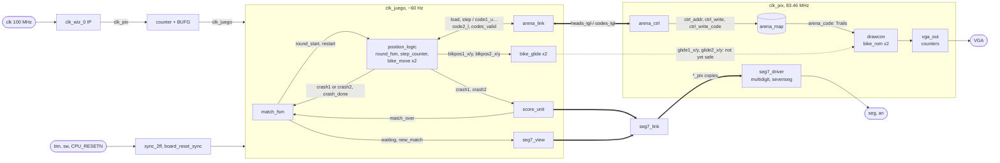
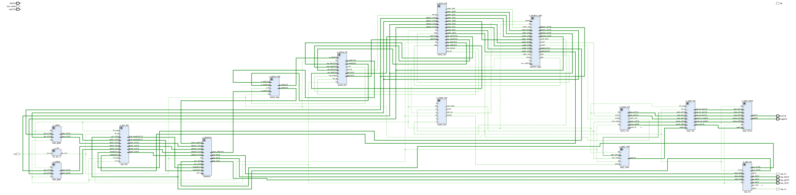
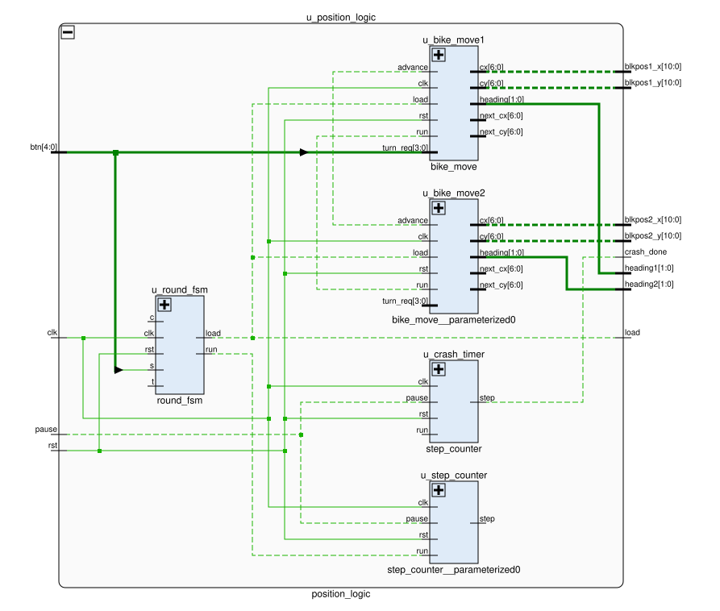
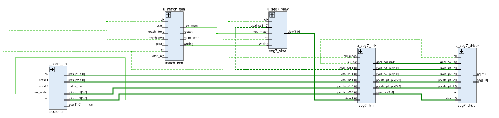

# `proyecto_final/`: Tron on VGA

The two-player Tron game for the CS-256 class project, in SystemVerilog for the Nexys A7-100T.

Two Bikes move one Cell per Step on a grid and leave a Trail. A Bike that hits a wall, a Trail or the other Bike loses a Life, and if only one crashed, the other gets the Survival Bonus (+3). A Match ends when a Player has no Lives left. The eight 7-segment digits show the Points and the Lives, and the Points Goal while waiting for a new Match.

- **Video:** 1280 × 800 VGA, pixel clock 83.46 MHz (`clk_pix`).
- **Game:** a ~60 Hz clock (`clk_juego`).
- **Inputs:** P1 turns with the board buttons. P2 goes straight for now: its input, a web page over the USB-UART, is planned.
- **Not yet:** Rewards (G4).
- **Board status:** the current build was checked on the board on 17 November 2026: [`bitstreams/README.md`](bitstreams/README.md).

**Where the rules come from:**
- [Agreed specification of 20 October](../docs/decisions/CS-256%20Tron%20Agreed%20Specification%202026-10-20.md): the rules, locked.
- [Interface contract](Contrato%20de%20interfaces%20game_top%20%28CS%20256%29.md): modules, signals and who owns each block. It is Roman's, in Spanish.
- [ADRs](../docs/adr/): later team decisions.
- The course handout is general guidance ([ADR 0006](../docs/adr/0006-single-wizard-counter-game-clock-and-handout-as-guidance.md)). Where this design departs from it, [ADR 0009](../docs/adr/0009-handout-names-and-where-proyecto-final-departs.md) gives the file, line and reason.

**Design notes:** the [VGA and sprite plan](../docs/design/CS-256%20VGA%20and%20Sprite%20Design%20Plan.md) and the [FPGA coding practices](../docs/design/CS-256%20Official%20FPGA%20Coding%20Practices.md).

## Block diagram

Blocks are grouped by clock domain. A thick arrow is a crossing between the two clocks. Arrows are labelled with the signal names in `game_top`.



### Vivado's schematics

The pages in [`diagrams/`](diagrams/) are Vivado's own RTL schematics (*RTL Analysis → Schematic*) of the elaborated design, exported by [`schematics.tcl`](schematics.tcl).
- Only module instances are drawn. The logic between them is left out, so a dashed line is a net that passes through logic not shown.
- Open an SVG on its own to zoom in.
- Redrawn on 18 November 2026 with the [renamed signals](#renamed-signals). `round_fsm` is Roman's, so page 2 still shows its `s`, `c` and `t` inputs.

| Page | Shows |
|---|---|
| [`1-game_top.svg`](diagrams/1-game_top.svg) | Every block in `game_top` except the synchronizers, with the board pins |
| [`2-position_logic.svg`](diagrams/2-position_logic.svg) | Inside `position_logic`: `round_fsm`, the two `step_counter`s and the two `bike_move`s |
| [`3-scoreboard.svg`](diagrams/3-scoreboard.svg) | The Match and the Scoreboard: `match_fsm`, `score_unit`, `seg7_view`, `seg7_link`, `seg7_driver` |







## Clocks and crossings

| Clock | Source | Frequency |
|---|---|---|
| `clk_pix` | `clk_wiz_0` (Clocking Wizard IP) from the 100 MHz board clock | 83.46 MHz requested, 83,455,882 Hz achieved |
| `clk_juego` | A counter on `clk_pix` that toggles every `CLK_JUEGO_N` = 695,466 cycles, through a `BUFG` ([ADR 0006](../docs/adr/0006-single-wizard-counter-game-clock-and-handout-as-guidance.md)) | 59.99997 Hz |

`constraints/game_top_timing.xdc` defines `clk_juego` as a generated clock. `build_game_top.tcl` checks that its `-divide_by` is 2 × `CLK_JUEGO_N`.

| What crosses | From → to | How | Constraint in `constraints/game_top_timing.xdc` |
|---|---|---|---|
| CPU_RESETN | pin → each clock | `board_reset_sync`, one per domain | false path to the first flip-flop |
| Buttons, SW0, SW14–SW15 | pins → `clk_juego` | `sync_2ff` | false path to the first flip-flop |
| SW0–SW11 | pins → `clk_pix` | `sync_2ff` | false path to the first flip-flop |
| Arena heads and neighbour codes | `clk_juego` ↔ `clk_pix` | `arena_link` sends the heads with `heads_tgl`; `arena_ctrl` answers with `codes_tgl`. Each toggle goes through `sync_2ff`, and the data is copied only after it changes | `set_max_delay -datapath_only` of one pixel period (11.982 ns) |
| Scoreboard values (20 bits) | `clk_juego` → `clk_pix` | `seg7_link`: the same toggle (`tick_toggle`) and copy | the same one-pixel bound |
| Drawn Bike positions and Headings | `clk_juego` → `clk_pix` (`drawcon`, `bike_rom`) | **none yet**: `drawcon` reads `glide1_x/y`, `glide2_x/y` and `heading1/2` directly | a one-pixel bound only. Not a safe crossing; a Bike is sometimes drawn cut ([issue #30](https://github.com/romanmg00/FPGA/issues/30)) |

## Controls

| Control | Does |
|---|---|
| BTNU, BTNR, BTND, BTNL | Turn P1 |
| BTNC | Start a Round; after a Match ends, start a new Match |
| CPU_RESET | Reset |
| SW0 | Pause: the Bikes, Turns and game timers stop; video and display keep running |
| SW14, SW15 | Points Goal: 10 with both down, 20, 30 or 40 |
| SW1–SW11 | Wired to `drawcon`, not used yet |

The Scoreboard shows `P2 nn P1 nn` (Points) and `L2 nn L1 nn` (Lives), 3 s each. While waiting for a new Match, it also shows `GOAL  nn`; moving SW14/SW15 then jumps to it ([ADR 0008](../docs/adr/0008-scoreboard-goal-page-before-a-match.md)).

## Modules

- **Owner** is the person responsible for the block, from the table in the contract's §4 (*Interfaz módulo por módulo*).
- **Written by** comes from the first line of each file (see [Who wrote what](#who-wrote-what)).
- Testbenches are listed with the person who wrote them.
- The design files are in [`src/`](src/) and the testbenches in [`testbenches/`](testbenches/).

| File | What it does | Clock | Owner | Written by | Testbench |
|---|---|---|---|---|---|
| **Video** | | | | | |
| `counters.sv` | `hcnt` 0–1679 per line, `vcnt` 0–827 per frame | `clk_pix` | Roman | Roman | `counters_tb` (Roman; not self-checking, not run by the build) |
| `vga_out.sv` | Sync pulses, blanking, `curr_x`/`curr_y` | `clk_pix` | Roman | Roman | `vga_out_tb` (Roman) |
| `drawcon.sv` | Colour of each pixel: walls, HUD, Trails, Bike sprites | `clk_pix` | Roman | Roman; changes by Alan | through `game_top_tb` (Alan) |
| `bike_glide.sv` | Drawn position of one Bike, sliding from its previous Cell to its current one ([ADR 0010](../docs/adr/0010-bikes-sliding-between-cells.md)) | `clk_juego` | not in §4 | Alan | `bike_glide_tb` (Alan) |
| **Movement** | | | | | |
| `position_logic.sv` | Both Bikes: Turns, Steps, and Crashes with walls, Trails and each other | `clk_juego` | Roman (G1/G2) | Roman; changes by Alan | `position_logic_tb` (Roman; changes by Alan) |
| `round_fsm.sv` | One Round: wait for Start, run, Crash pause, wait for Start's release | `clk_juego` | to confirm: G1/G2 is Roman's, G3 (Rounds) Alan's | Roman | `round_fsm_tb` (Roman) |
| `step_counter.sv` | A 1-tick pulse every `STEP_TICKS` ticks; also the 2 s Crash timer | `clk_juego` | Roman (G1/G2) | Roman | `step_counter_tb` (Roman) |
| `bike_move.sv` | One Bike's Cell, Heading and pending Turn | `clk_juego` | Roman (G1/G2) | Roman | `bike_move_tb` (Roman) |
| **Arena** | | | | | |
| `arena_map.sv` | Arena memory: 8192 Cells × 4-bit code (BRAM) | `clk_pix` | Alan (A1/A2) | Alan | `arena_map_tb` (Alan) |
| `arena_ctrl.sv` | The only writer of `arena_map`: prepares a Round, writes each Step, reads the Cells around each head | `clk_pix` | Alan (A1/A2) | Alan | `arena_ctrl_tb`, `arena_tb` (Alan) |
| `arena_link.sv` | Game side of the Arena crossing | `clk_juego` | Alan (A1/A2) | Alan | `arena_tb` (Alan) |
| **Match** | | | | | |
| `match_fsm.sv` | The Match: Start, Rounds, Crash display, Match over, new Match (8 states) | `clk_juego` | Alan (G3/G5) | Alan | `match_fsm_tb`, `match_tb` (Alan) |
| `score_unit.sv` | Lives, Points, Survival Bonus, winner or Draw | `clk_juego` | Alan (G3/G5) | Alan | `score_unit_tb`, `match_tb` (Alan) |
| **Scoreboard** | | | | | |
| `seg7_view.sv` | Which view is shown (Points, Lives, Goal), 3 s each | `clk_juego` | Alan (display) | Alan | `seg7_view_tb` (Alan) |
| `seg7_link.sv` | Carries the 20 Scoreboard bits to `clk_pix` | both | Alan (display) | Alan | `seg7_link_tb` (Alan) |
| `seg7_driver.sv` | Turns Points, Lives and the Goal into eight digits | `clk_pix` | Alan (display) | Alan | `seg7_driver_tb` (Alan) |
| `multidigit.sv` | Scans the eight digits on one set of segment pins | `clk_pix` | Alan (display) | Alan, from his homework 1 | `multidigit_tb` (Alan) |
| `sevenseg.sv` | 7-segment decoder: 0–9, P, L, G, A, blank | none | Alan (display) | Alan, from his homework 1 | `sevenseg_tb` (Alan) |
| **Board I/O and top** | | | | | |
| `sync_2ff.sv` | 2-flip-flop synchronizer for one button or switch | any | Alan | Alan | `sync_2ff_tb` (Alan) |
| `board_reset_sync.sv` | CPU_RESET into one clock domain | any | Alan | Alan | `board_reset_sync_tb` (Alan) |
| `game_top.sv` | Top level: clocks, reset, synchronizers, every block above | both | Alan; the Wizard and the `clk_juego` counter: Roman | Roman and Alan | `game_top_tb` (Alan): 9 scenarios, read from the pins |

| Other file | What it is | Owner | Written by |
|---|---|---|---|
| `constraints/game_top.xdc` | Pins and board configuration | Alan | Roman, from Digilent's master XDC; changes by Alan |
| `constraints/game_top_timing.xdc` | `clk_juego` and the crossing constraints; implementation only | Alan | Alan |
| `build_game_top.tcl` | Runs the testbenches and builds the bitstream | Alan | Alan |
| `schematics.tcl` | Exports the schematics in `diagrams/` | Alan | Alan |
| `ip/` | IP settings: `clk_wiz_0`, `bike_rom`, `reward_rom` (`.xci` and scripts to recreate them) | Roman | Roman |
| `sprites/` | Sprite data (`.coe`, RGB444) | Roman | Roman |
| `sim_clocks/`, `sim_models/` | **Simulation only**: an ideal `clk_wiz_0` and a `bike_rom` model. Never synthesized | — | Alan |

## Simulate and build

`build_game_top.tcl` runs the self-checking testbenches (all but `counters_tb`) and builds `game_top` from the repository, with no Vivado project needed beforehand. It needs Linux and full Vivado.

1. From the repository root, pick a new output folder and a mode:

   ```bash
   vivado -mode batch -source proyecto_final/build_game_top.tcl -tclargs OUT_DIR [quick|sim|full]
   ```

2. Pick the mode:
   - **`quick`** runs the module testbenches only, in about 20 s. Use it while working.
   - **`sim`** also runs the 9 `game_top_tb` scenarios, up to about 20 minutes.
   - **`full`** also creates the IP from the IP Catalog, synthesizes, implements and writes the bitstream.
   - Run `sim` or `full` before every push or PR.
3. Read the result:
   - `OUT_DIR/tests/PASS.txt` means every testbench the mode runs passed (`quick` skips `game_top_tb`).
   - In `full`, `OUT_DIR/BUILD_COMPLETE.txt` and `OUT_DIR/game_top.bit` appear only if routed timing is met. The timing, CDC, DRC and methodology reports are in `OUT_DIR`.

Roman's Vivado project on the remote workstation loads the same files from a clone: see [`comandos_vivado_myws.md`](comandos_vivado_myws.md).

To redraw the schematics, run this after a `full` build:

```bash
xvfb-run -a vivado -mode gui -source proyecto_final/schematics.tcl \
    -tclargs proyecto_final/diagrams OUT_DIR/project/game_top.xpr exit
```

## Test on the board

1. Program [`bitstreams/game_top_match_scoreboard.bit`](bitstreams/) by JTAG: Vivado Hardware Manager → *Open Target* → *Program Device*.
2. Follow the nine checks in [`bitstreams/README.md`](bitstreams/README.md).

Programming by JTAG is not kept after a power cycle: the board then loads whatever is in its flash.

## Folders

| Path | Contents |
|---|---|
| `src/` | The design modules: everything that is synthesized |
| `testbenches/` | The testbenches (`*_tb.sv`) |
| `constraints/` | Pins (`game_top.xdc`) and timing (`game_top_timing.xdc`) |
| `build_game_top.tcl`, `schematics.tcl` | The build and the schematic export |
| `diagrams/` | Vivado's schematics |
| `ip/`, `sprites/` | IP settings and sprite data |
| `sim_clocks/`, `sim_models/` | Simulation-only stand-ins for the Wizard and `bike_rom` |
| `bitstreams/` | The last bitstream checked on the board, with its checks |
| `prototypes/` | Experiments that are not part of the design: `core_blocks/` (a playable prototype), `uart_input/` (P2's input) and `vga_106mhz/` |
| `deprecated/` | Earlier versions of this README and of the contract |
| `Contrato de interfaces game_top (CS 256).md` | The team's interface contract (Roman's, in Spanish) |
| `comandos_vivado_myws.md` | Roman's Vivado commands for the remote workstation (Spanish) |

## Moved files

The files at the top of this folder moved into folders in PR #50 (after 19 November 2026). Older documents still name the old paths:

| Old path in `proyecto_final/` | New path |
|---|---|
| `arena_ctrl.sv`, `arena_link.sv`, `arena_map.sv`, `bike_glide.sv`, `bike_move.sv`, `board_reset_sync.sv`, `counters.sv`, `drawcon.sv`, `game_top.sv`, `match_fsm.sv`, `multidigit.sv`, `position_logic.sv`, `round_fsm.sv`, `score_unit.sv`, `seg7_driver.sv`, `seg7_link.sv`, `seg7_view.sv`, `sevenseg.sv`, `step_counter.sv`, `sync_2ff.sv`, `vga_out.sv` | `proyecto_final/src/` |
| every `*_tb.sv` | `proyecto_final/testbenches/` |
| `game_top.xdc`, `game_top_timing.xdc` | `proyecto_final/constraints/` |
| `cs256-project1-fall26.pdf` | [`docs/references/`](../docs/references/cs256-project1-fall26.pdf) |

## Renamed signals

On 18 November 2026 Alan renamed signals in his modules so each name says what it carries, simplified `arena_ctrl`'s and `match_fsm`'s state machines, and shortened the comments in `arena_map`, `arena_ctrl`, `match_fsm`, `drawcon` and `position_logic`. The game behaves the same. The one difference at a port: `arena_ctrl` no longer clears its codes on reset, so `neighbours_p1/p2` hold old values until the next answer, and `arena_link` reads them only on an answer. Older documents, including the contract's §3 and §4, still use the old names. The rules:

- The handout's and the slides' names are kept: `blkpos_x/y`, `curr_x/y`, `draw_r/g/b`, `pix_*`, `hsync`, `vsync`. `bike_glide` now takes `blkpos_x/y`, and no longer outputs `draw_x/y`, which in the handout means the current pixel.
- Roman's modules (`position_logic`, `round_fsm`, `bike_move`, `drawcon`, `counters`, `vga_out`) keep their code and names; only the comments in `position_logic` and `drawcon` were shortened. The ports they share keep their names: `code1_u`…`code2_l`, `crash1`, `crash2`, `turn_req2`.
- One signal per Player ends in `_p1`/`_p2` (contract §1). `_last` is a signal one tick earlier, `_tgl` a toggle that crosses clocks, `_sync` its synchronized copy, `_pix` a copy on `clk_pix`, and `_ff` the flip-flop behind an output port.

| Module | Old | New |
|---|---|---|
| `arena_map` | `a_addr`, `a_we`, `a_wdata`, `a_rdata` | `ctrl_addr`, `ctrl_write`, `ctrl_write_code`, `ctrl_read_code` (`arena_ctrl`'s port) |
| | `b_addr`, `b_rdata` | `draw_addr`, `draw_code` (`drawcon`'s port) |
| | `mem`, `b_word` | `cells`, `draw_code_stage1` |
| `arena_link` ↔ `arena_ctrl` | `req_tgl`, `ack_tgl` | `heads_tgl`, `codes_tgl` |
| | `req_prepare` | `prepare` |
| | `req_old1/2`, `req_new1/2` | `old_head_p1/p2`, `new_head_p1/p2` |
| | `nbr1/2` | `neighbours_p1/p2` |
| `arena_ctrl` | `req_sync`, `ack_q` | `heads_tgl_sync`, `codes_tgl_ff` |
| | `prepare_q`, `old1_q`…`new2_q` | `prepare_pix`, `old_head_p1_pix`…`new_head_p2_pix` |
| | `st`, `cnt`, `head` | `state`, `count`, `read_head` |
| | `s_trail1`, `s_trail2`, `s_head1`, `s_head2` | one `s_write`, whose `count` 0–3 picks the write (a Prepare starts at 2) |
| | `s_done`, `rd_valid` | removed: `s_read` counts 0–8 and takes each code one count after its read |
| `arena_link` | `req_q`, `ack_sync`, `ack_seen` | `heads_tgl_ff`, `codes_tgl_sync`, `codes_tgl_last` |
| | `load_q`, `prep_wait`, `step_wait` | `load_last`, `prepare_pending`, `step_pending` |
| | `send_prep`, `answer`, `head1/2` | `send_prepare`, `codes_arrived`, `head_p1/p2` |
| `match_fsm` | `s`, `c`, `t`, `m`, `p` | `start_btn`, `crash`, `crash_done`, `match_over`, `pause` |
| | `st`, `nst`, `s_q`, `press` | `state`, `next_state`, `start_btn_last`, `start_press` |
| | `start_go` | `round_start` |
| | states `3'd0`…`3'd7` | an `enum`, `s_idle`…`s_start`, as in `round_fsm`; same codes 0–7 |
| `bike_glide` | `STEPS`, `pos_x/y`, `draw_x/y` | `STEP_TICKS`, `blkpos_x/y`, `glide_x/y` |
| | `seen_x/y`, `g`, `g_next`, `fx/fy`, `off` | `blkpos_x_last/y_last`, `glide_tick`, `glide_tick_next`, `from_x_next/y_next`, `offset_px` |
| `seg7_view` | `last_sel`, `sel_changed` | `goal_sel_last`, `goal_sel_changed` |

## Who wrote what

The first line of each design file, testbench, constraint file and script names who wrote it. For example:

```systemverilog
// Author: Roman (romanmg00). Changes by Alan (AIF31): Trails read from arena_map's port B (#40),
// sprite colour 000 drawn as transparent (#39).
```

- **Author** is who wrote the first working version that the file grew from. If that version came from elsewhere, the line says so: "adapted from his CS-256 homework 1", "from Digilent's master XDC".
- **Changes by** lists the other person's changes to behaviour that are still in the file, with their PRs. Renames, comments and changes later replaced are left out.
- **Authors** names both when both wrote a large part of what is there now (`game_top.sv`).

[`tools/proyecto_final_authors.sh`](../tools/proyecto_final_authors.sh) prints the evidence for each file: who created it, each person's commits, and each person's current lines (`git blame`). The headers were written by hand from it and confirmed by each of us. `git blame` counts lines, not ideas: renaming a signal or reformatting a line credits it to whoever did that.

The **Owner** column of [Modules](#modules) is a different thing: who is responsible for the block in the contract. The two differ in places, and both are shown.

## Use of AI tools

Alan (AIF31) used AI coding assistants in this project for:

- **Ideation:** comparing design options before the team chose one; the choices are recorded in [`docs/adr/`](../docs/adr/).
- **Debugging:** reading simulation output and Vivado reports to find the cause of failures.
- **Testbenches:** drafting self-checking testbenches, which Alan reviewed and ran.
- **SystemVerilog and build automation:** help writing SystemVerilog, and automating the flow from simulation to synthesis, implementation and the bitstream (`build_game_top.tcl`).

Each file's header names the person responsible for it, who reviewed its content and can explain it.

## History

Built one step (Paso) at a time:

| Paso | What | Who, PR |
|---|---|---|
| 1–3a | Counters and `vga_out` | Roman |
| 4a | Clocking Wizard at 83.46 MHz, stable image on the board | Roman |
| 5a | Moving block: walls, HUD, game clock, buttons | Roman, #11; reset and startup fixes by Alan, #12 |
| 4c | `clk_juego` from a counter on `clk_pix`, one Wizard (ADR 0006) | Alan, #16 |
| 6a, 6b | One Bike in Rounds, then two Bikes with Crashes | Roman, #21, #25 |
| 6c, 6e | Step interval, and Bikes sliding between Cells (ADR 0010) | Alan, #28, #31; Roman chose 8 ticks, #35 |
| 5c | Bike sprites from `bike_rom` | Roman, #35 |
| 5b, 6d, 6f | The Arena: Trails and Crashes into Trails | Alan, #40 |
| 7a, 7b | Scoreboard display and views | Alan, #34 |
| 7c, 7d | Match, Lives, Points and the Scoreboard in `game_top` | Alan, #46, #47; Roman's `position_logic` ports, #45 |

The full step log, in Spanish, is in [`docs/history/proyecto_final-pasos.md`](../docs/history/proyecto_final-pasos.md).

**Still open:**
- `tick_60hz` in `vga_out` (Paso 3b).
- The 10 px white border (Paso 4b).
- Reward sprites and Rewards (G4).
- The positions crossing (X1, issue #30).
- P2's UART input.
- Moving `bike_glide` into `position_logic` (issue #37).
