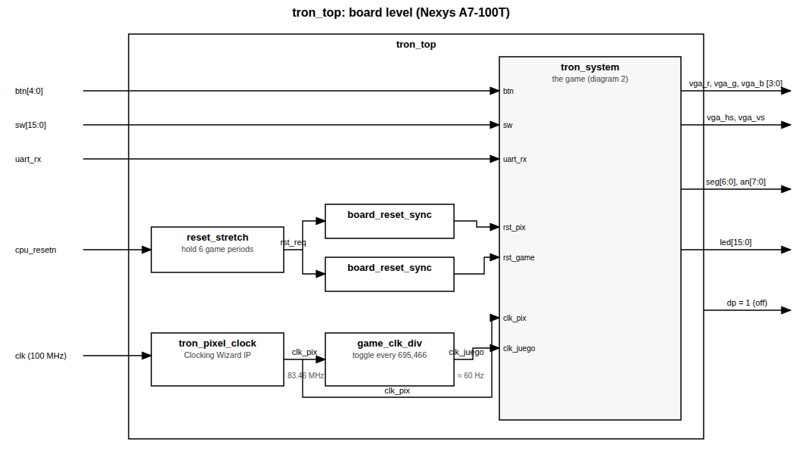
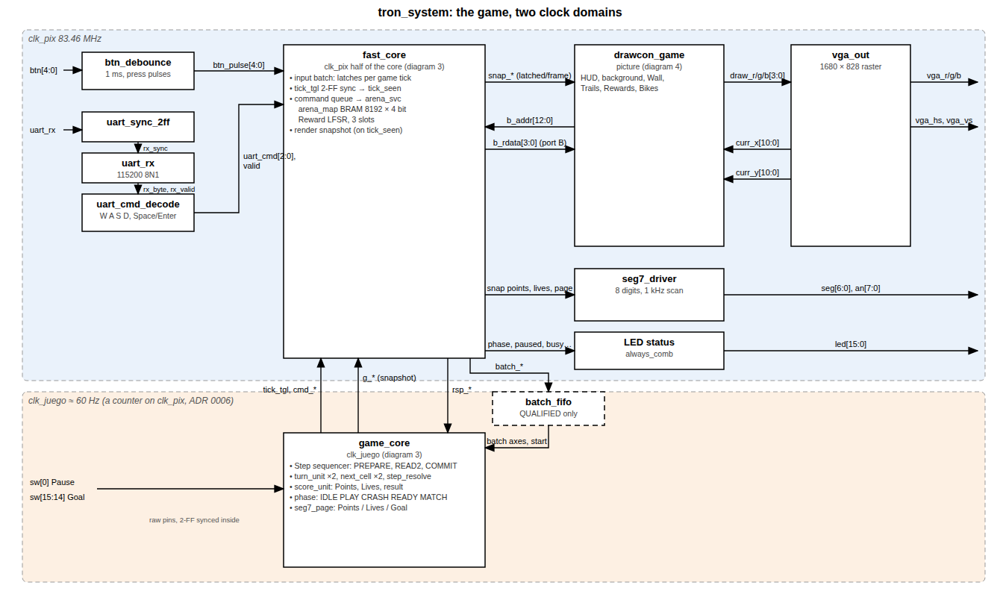
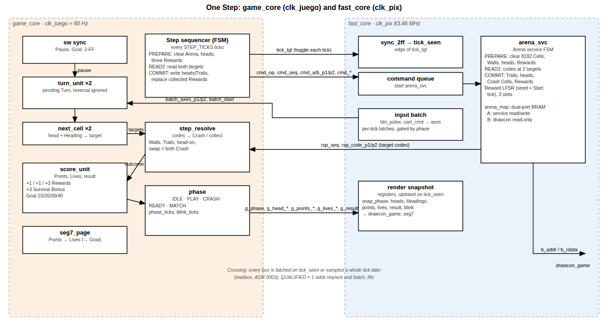
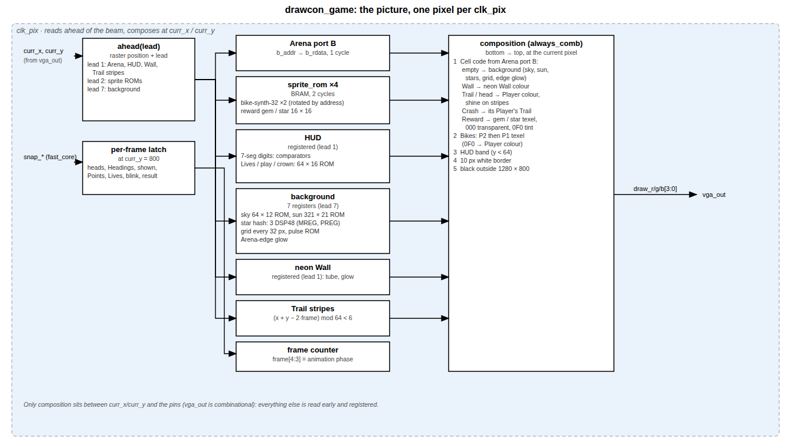

# Core blocks: provisional SystemVerilog feasibility experiments

Started 29 October 2026. These are the most basic blocks of the Tron game, each
built against the contract and the working defaults of
[ADR 0003](../../../docs/adr/0003-step-transaction-mailbox-and-render-codes.md),
then simulated and synthesized to test whether the prototype's design choices
hold in hardware. Under [ADR 0005](../../../docs/adr/0005-build-with-provisional-interfaces.md)
(proposed) every port, timing and handshake here that the contract does not
already state is **provisional**. Passing these benches is **evidence**, not team
agreement; the testbenches here are the builder's own checks, not the
**official** testbenches of contract §7, which the other owner writes.

> **Prototype only.** Everything in this folder, the playable `game/` build
> (`tron_top`) included, shows how the game *could* be implemented. It is not
> the design delivered to the TAs, and no file here is instantiated, included
> or copied directly into the top-level `proyecto_final/` design. The final
> game is built step by step in `proyecto_final/`; use this folder as a
> reference for ideas, timing evidence and the synthwave look. Some module
> names repeat the top-level ones (`vga_out`, `sync_2ff`, `board_reset_sync`),
> so every build script here lists its sources explicitly; never glob across
> both trees.

## Layout

| Path | Contents |
|---|---|
| `game_pkg.sv` | Contract §5 package as copied on 29 October 2026. It keeps `STEP_TICKS = 6`, the value these benches and reference logs were made with; since PR #26 the contract and `proyecto_final/` use 8 ([ADR 0007](../../../docs/adr/0007-configurable-step-interval.md)). The game benches pass the interval as a parameter |
| `game_pkg_tb.sv` | Checks the package's derived constants |
| `run_xsim.sh` | One self-checking XSim bench in the Vivado 2025.2 container |
| `run_synth.sh` | Out-of-context synthesis: utilization, latches, RAM inference, timing |
| `run_all.sh` | Reruns every block bench in parallel and summarizes |
| `video/`, `arena/`, `step/`, `score/`, `io/` | Round one: one folder per block set, with modules, benches, `FINDINGS.md` and `evidence/` |
| `datapath/` | Round two: the Step transaction across two clocks, driven by a model trace |
| `board/` | Round two: board test-pattern bitstream (clocks, Arena, drawcon) |
| `game/` | The playable core: `tron_top` bitstream and flash image, M2 replay of the full HDL game, end-to-end pins bench, P2 web page, board checklist, the quick look loop (`look_loop.sh`) and the block diagrams (`diagrams/`, see [Architecture](#architecture-of-the-playable-core-tron_top)) |
| `tools/` | Host scripts used only by this prototype (moved from the repository's `tools/` on 15 November 2026): `png2coe.py` (`.coe` + `.mem` sprite ROMs), `make_hud_icons.py`, `make_bg_luts.py`, `look_frame.py`, `hdl_frame_to_png.py`, `make_block_diagrams.py`. Run them from the repository root. The SHA-256 tables in `game/FINDINGS.md` name them at their old `tools/` paths, as they were when hashed |
| `crossing/` | The game-fast crossing experiment (ADR 0003 item 2, ADR 0007): req/ack responses, `batch_fifo`, protocol benches, routed CDC comparison; also the research note's clock probe |

## Architecture of the playable core (`tron_top`)

A reference for the final `proyecto_final/` game: how the blocks of
[`game/`](game/) fit together, what each one takes and gives, and where the
two clocks meet. Every port, timing and handshake here is **provisional**
(ADR 0005) until the contract records it; the code is the authority on the
current behaviour. As of 12 November 2026 (branch `hdl/synthwave-look`), this
build is in the board's flash ([game/FINDINGS.md](game/FINDINGS.md), section 12).

The diagrams follow the course handout's `game_top.png`. They are drawn from
the module ports by `proyecto_final/prototypes/core_blocks/tools/make_block_diagrams.py`; regenerate them when ports
change (`python3 proyecto_final/prototypes/core_blocks/tools/make_block_diagrams.py proyecto_final/prototypes/core_blocks/game/diagrams`,
then a PNG per SVG). Vivado's own schematics of a built netlist, one page per
level, are in [`game/diagrams/vivado/`](game/diagrams/vivado/) (PDF and SVG;
`game/run_schematic.sh [tron-BUILD]`). They are exact but dense: zoom in.

### 1. Board level



| Pin | Width | Dir | Goes to | Use |
|---|---|---|---|---|
| `clk` | 1 | in | IBUF → `tron_pixel_clock` (Clocking Wizard IP) | 100 MHz board clock; feeds only the Wizard |
| `cpu_resetn` | 1 | in | `reset_stretch` | Reset button, active low |
| `btn[4:0]` | 5 | in | `btn_debounce` | P1: `{C, R, L, D, U}` = Start, Right, Left, Down, Up |
| `sw[0]` | 1 | in | `game_core` (2-FF) | Pause |
| `sw[15:14]` | 2 | in | `game_core` (2-FF) | Points Goal 10/20/30/40, taken at Match start |
| `uart_rx` | 1 | in | `uart_sync_2ff` → `uart_rx` | P2 from `game/p2_controller.html`: 115200 8N1, W A S D, Space/Enter |
| `vga_r/g/b[3:0]` | 12 | out | `vga_out` | RGB444 |
| `vga_hs`, `vga_vs` | 2 | out | `vga_out` | 1280 × 800 at ≈ 60 Hz (1680 × 828 raster) |
| `seg[6:0]`, `an[7:0]` | 15 | out | `seg7_driver` | Scoreboard: P2 left, P1 right; Points / Lives (/ Goal) pages |
| `dp` | 1 | out | constant 1 | Decimal points off |
| `led[15:0]` | 16 | out | LED status | `[2:0]` phase, `[3]` paused, `[4]` late publish, `[5]` Arena service busy, `[6]` UART framing error seen, `[7]` UART byte toggle, `[8]` batch_fifo overflow, `[15]` ≈ 1 Hz beat |

| Clock or reset | Made by | Value | Used by |
|---|---|---|---|
| `clk_pix` | `tron_pixel_clock` (one Clocking Wizard, ADR 0006) | 83.455882 MHz | everything except `game_core` |
| `clk_juego` | `game_clk_div` on `clk_pix`, toggles every 695,466 cycles, BUFG | 59.99997 Hz | `game_core` |
| `rst_req` | `reset_stretch` (2-FF on `cpu_resetn`) | held for 6 game periods | both reset synchronizers |
| `rst_pix`, `rst_game` | `board_reset_sync` per domain (2-FF, `ASYNC_REG`) | synchronous, active high | their domain |

### 2. The game (`tron_system`)



| Module (file) | Domain | Role |
|---|---|---|
| `btn_debounce` (`io/`) | clk_pix | 2-FF per button, 1 ms debounce, one-cycle press pulses `btn_pulse[4:0]` |
| `uart_sync_2ff`, `uart_rx`, `uart_cmd_decode` (`../uart_input/`) | clk_pix | 8N1 receiver; W D S A → `uart_cmd` 0–3 (= `DIR_*`), Space/Enter → 4 (Start) |
| `game_core` (`game/`) | clk_juego | Rules: Step sequencer, Turns, Step resolution, score, phase, Scoreboard page |
| `fast_core` (`game/`) | clk_pix | Arena service and memory, input batch, render snapshot |
| `batch_fifo` (`crossing/`) | both | Gray FIFO for input batches; only with `QUALIFIED = 1` |
| `drawcon_game` + 4 × `sprite_rom` (`game/`) | clk_pix | The picture (section 4) |
| `vga_out` (`video/`) | clk_pix | Raster counters, sync pulses, `curr_x`/`curr_y`; combinational outputs (Decision B) |
| `seg7_driver` + `seg7_page` (`io/`) | clk_pix / clk_juego | 8-digit scan at 1 kHz; the page (Points, Lives, Goal) is chosen in `game_core` |

| From → to | Signals | Domain / crossing |
|---|---|---|
| `btn_debounce` → `fast_core` | `btn_pulse[4:0]` | clk_pix |
| `uart_cmd_decode` → `fast_core` | `uart_cmd[2:0]`, `uart_cmd_valid` | clk_pix |
| `game_core` → `fast_core` | `tick_tgl` (toggles every game tick) | 2-FF → `tick_seen` |
| `game_core` → `fast_core` | `cmd_op[1:0]` (1 PREPARE, 2 READ2, 3 COMMIT), `cmd_seq[3:0]`, `cmd_new_match`, `cmd_seed_mix[31:0]`, `cmd_a_p1/p2[12:0]`, `cmd_b_p1/p2[12:0]`, `cmd_survive_p1/p2`, `cmd_collected[2:0]` | latched on `tick_seen` (mailbox) |
| `fast_core` → `game_core` | `rsp_seq[3:0]`, `rsp_code_p1/p2[3:0]` (Cell codes at the two targets) | quiet window, sampled a tick later; req/ack with `QUALIFIED` |
| `fast_core` → `game_core` | `batch_axes_p1/p2[3:0]` (`{v_valid, v_down, h_valid, h_left}`), `batch_start` | as above, or `batch_fifo` |
| `game_core` → `fast_core` | `g_phase[2:0]`, `g_paused`, `g_phase_ticks[7:0]`, `g_blink_ticks[4:0]`, `g_head_p1/p2[12:0]`, `g_shown_p1/p2[1:0]`, `g_crashed_p1/p2`, `g_points_p1/p2[5:0]`, `g_lives_p1/p2[1:0]`, `g_result[1:0]`, `g_page_lives`, `g_page_goal`, `g_goal_sel[1:0]` | latched on `tick_seen` into `snap_*` |
| `fast_core` → `drawcon_game` | `snap_*` (as above), Arena port B `b_rdata[3:0]` | clk_pix; `drawcon_game` latches `snap_*` once per frame |
| `drawcon_game` → `fast_core` | `b_addr[12:0]` = `{cy[5:0], cx[6:0]}` | clk_pix, read-only port |
| `drawcon_game` → `vga_out` | `draw_r/g/b[3:0]` | clk_pix |
| `vga_out` → `drawcon_game` | `curr_x[10:0]`, `curr_y[10:0]` (the pixel on the pins now) | clk_pix |
| `fast_core` → `seg7_driver` | `snap_points_p1/p2`, `snap_lives_p1/p2`, `snap_page_lives`, `snap_page_goal`, `snap_goal_sel` | clk_pix |

Positions are Cell addresses `{cy[5:0], cx[6:0]}`, 13 bits: 80 × 50 Cells of
16 px on a 128 × 64 grid, so `cx = x[10:4]` and `cy = y[9:4]` without
multiplying. Cell codes (`game_pkg.sv`): 0 empty, 1 Wall, 2/3 P1 Trail/head,
4/5 P2 Trail/head, 6 Crash, 8/9/10 Rewards (+1, +1, +3). `result`: 0 none,
1 P1, 2 P2, 3 Draw. Phases: 0 IDLE, 1 PLAY, 2 CRASH, 3 READY, 4 MATCH.

### 3. One Step across the two clocks



Every `STEP_TICKS` game ticks (6 in the board build; ADR 0007) `game_core`
sends **READ2** with the two target Cells, `fast_core`'s `arena_svc` reads them
from the Arena and answers with their codes, `step_resolve` decides Crashes and
collected Rewards, `score_unit` updates Points and Lives, and **COMMIT** writes
the new heads, Trails, Crash Cells and replacement Rewards. **PREPARE** (Start
of a Round) clears the 8192 Cells, draws the Walls, places the heads and three
Rewards from the LFSR. `arena_map` is a true dual-port BRAM (8192 × 4 bit, one
RAMB36E1): port A belongs to `arena_svc`, port B to `drawcon_game`. The service
takes 2–8192 clk_pix cycles per command against ≈ 1.39 M per game tick
([arena/](arena/FINDINGS.md)).

### 4. The picture (`drawcon_game`)



| Source | Read from | Latency / look-ahead | Notes |
|---|---|---|---|
| Arena Cell | port B, `b_addr` | 1 cycle, position 1 ahead | Cell code of the current pixel |
| Bike sprites | `sprite_rom` × 2, `bike-synth-32.mem` | 2 cycles, position 2 ahead | 32 × 32 RGB444 pointing up, rotated by address; `000` transparent, `0F0` → Player colour |
| Reward sprites | `sprite_rom` × 2, gem / star `.mem` | 2 cycles | 16 × 16; `0F0` → Reward colour |
| HUD | comparators + 64 × 16 icon ROM | registered, 1 ahead | seven-segment digits, Life diamonds, play / crown |
| Background | sky, sun, grid ROMs, star hash (3 DSP48) | 7 registers, 7 ahead | sky `001`, sun, stars, grid pulsing over 4 phases |
| Wall | box comparators | registered, 1 ahead | black Wall, neon tube `F4D` and glow `726` |
| Trail stripes | `(x + y − 2 frame) mod 64 < 6` | registered, 1 ahead | Player colour, shine `CFF` / `FEC` |

The composition is the only logic between `curr_x`/`curr_y` and the pins,
because `vga_out` passes `draw_*` straight through: it picks, bottom to top,
the Cell (background, Wall, Trail, Crash, Reward), the Bikes, the HUD band, the
10 px white border, and black outside 1280 × 800. Bike positions, Headings and
the HUD values are latched once per frame at `curr_y = 800`, so a sprite never
tears. Routed slack on this path is small (+0.066 ns); registering `draw_*`
(Roman's open question in `docs/design/CS-256 VGA Output Timing Findings.md`)
is the remedy if a change fails timing.

## Writing a block

- SystemVerilog `.sv` only. Contract §1: `logic`, `snake_case`, one module per
  file named after the module, one signal per Player (`_p1`, `_p2`) and no array
  ports, synchronous active-high `rst`. `import game_pkg::*;` for constants.
- `always_ff` with `<=`; `always_comb` with `=`, assigning every output on every
  branch.
- The header comment names the owner (contract §4/§7), the clock domain, every
  crossing, and each **provisional** port or timing.
- Keep the code Icarus-compatible (`iverilog -g2012`), although Icarus is not
  installed here.

## Testing a block

Benches are self-checking. They print `PASS <bench_top>` only after every check
passed, and use `$fatal`/`$error` on failure. Derive expected values from the
agreed specification and the contract: those are the **independent** checks.
Comparing against the Python model (`prototipos/tron_fpga/model/`, headless,
`python3` run from `prototipos/tron_fpga/`) is useful but not independent proof.
Generated vector files live in the block folder with the script that made them.

```bash
# From anywhere; paths after the bench name are relative to proyecto_final/.
proyecto_final/prototypes/core_blocks/run_xsim.sh [-g NAME=VALUE]... BENCH_TOP FILE.sv...
proyecto_final/prototypes/core_blocks/run_synth.sh [-g NAME=VALUE]... [-c CLK_PORT PERIOD_NS]... TOP FILE.sv...
```

Both run through `sudo -n /usr/local/sbin/cs256-vivado`, so run them outside the
sandbox (request escalation). Each run copies `proyecto_final/` to a fresh
`/builds/core-*` folder; the host path is printed at the end. A bench that reads
a vector file opens it relative to the run folder: use
`src/prototypes/core_blocks/<block>/<file>`. `clk_pix` is 83.46 MHz, so
`-c clk_pix 11.982`. Synthesis is out of context, so it shows resources, latches,
RAM inference and logic depth; it is not routed sign-off.

## Recording findings

Each block folder has a `FINDINGS.md` that another agent can rerun from alone:

1. What was built, and which contract ports, working defaults and model files it
   follows; every deviation, with its reason.
2. Source state: `sha256sum` of each `.sv` and script, and Vivado 2025.2 from the
   container.
3. Each command run and its result (PASS markers, utilization, WNS/WHS, latch
   and RAM counts), with the host artifact path.
4. What the evidence shows, and what it does not show.
5. Limitations, risks to the design choice under test, and open questions for
   Roman and Alan.

Copy short logs worth keeping into `<block>/evidence/` (text only).

## Findings at a glance (29 October 2026)

Each folder's `FINDINGS.md` holds the commands, artifacts and limits.

- **Playable core** ([game/](game/FINDINGS.md)): the full HDL game, with Bike and
  Reward sprites from ROM (the synthwave art), reproduces the model's 12 M2
  Step logs exactly, `tick` included, at several clock phases and game
  periods. An end-to-end bench through the board pins passes 43 checks,
  including texel-exact sprite rows in all four Headings. `tron_top.bit` meets
  routed timing (WNS +0.202 ns on a VGA pad path, internal +2.30 ns;
  WHS +0.028 ns) using 1.62 % of the LUTs. Run on the board and written to its
  flash on 12 November 2026 ([game/FINDINGS.md](game/FINDINGS.md), section 12;
  checklist in section 5).
- **Crossing** ([crossing/](crossing/FINDINGS.md)): the model's stable-payload
  mailbox works, but its 21 fast-to-game capture registers are an unknown CDC
  in Vivado. Under ADR 0007 (8–10 ticks per Step), the "captured" variant
  replaces them with a req/ack response captured on a synchronized toggle and
  a Gray FIFO for input batches. It needs READ2 + COMMIT = 8 ticks, matches the
  model at 8 and 10 ticks, and routes with **0 unknown CDC and no waiver**.
  Inputs arrive 2 ticks later than with the mailbox. A 6-tick variant also
  works but needs a 5-endpoint waiver. Input for ADR 0003 item 2.
- **Fast clock** ([arena/](arena/FINDINGS.md)): `clk_pix` serves the Arena with large
  margin. CLEAR takes 8192 cycles, READ2 3 and COMMIT 2–4, against about
  1.39 M cycles per game tick; the 8192 × 4 Arena maps to one RAMB36E1.
- **Clocks** ([video/](video/FINDINGS.md)): 83.455882 MHz pixel clock;
  4.6875 MHz / 78126 gives 59.999 Hz `clk_juego` (−12.8 ppm). Frames and game
  ticks drift past each other about every 4.3 minutes.
- **`vga_out`** ([video/](video/FINDINGS.md)): Roman's registered outputs put the pins
  one cycle behind `curr_x`/`curr_y`. Fixed on 29 October to the handout's
  combinational outputs (Decision B); `vga_out_tb` and the independent
  `vga_out_check_tb` both pass. The cost is a long combinational path to the
  VGA pins (11.78 of 11.98 ns); Roman decides whether to keep it.
- **Contract gaps found**: CLEAR content of the HUD rows and padding;
  `score_unit` idle Lives (fixed to 03, as the model); `seg7_page` during Pause;
  `G_PREP`; the crossing; the Reward generator (the model's candidate LFSR is
  used, not yet selected).
